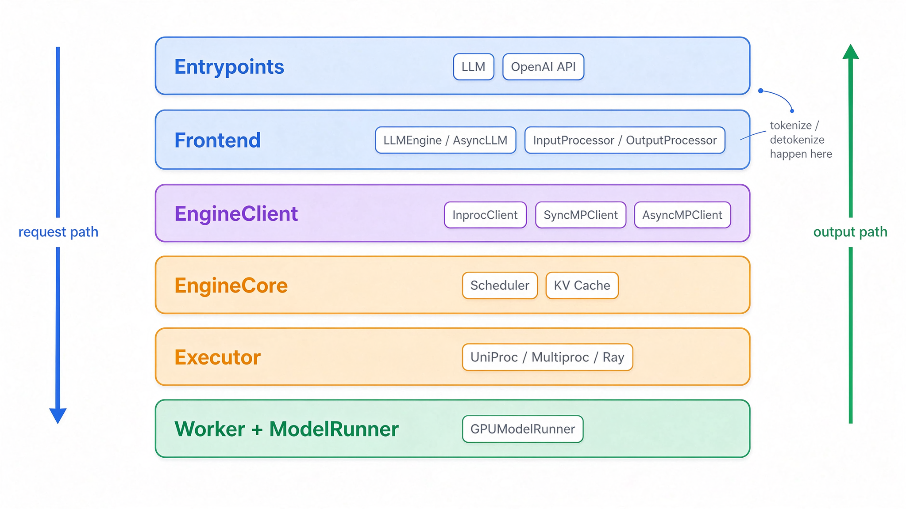
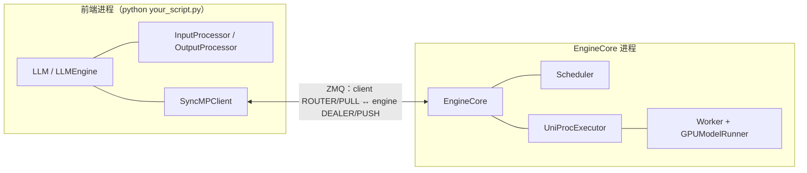
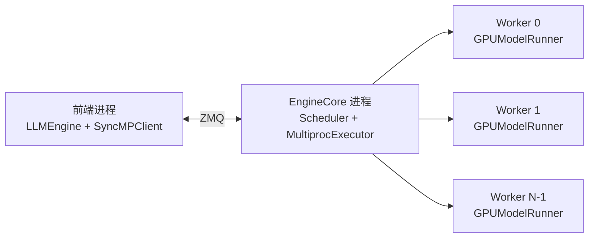
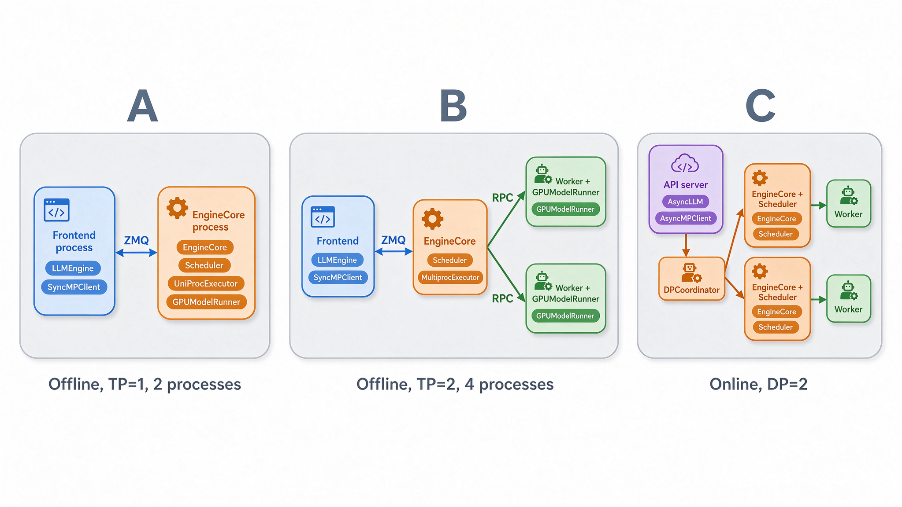
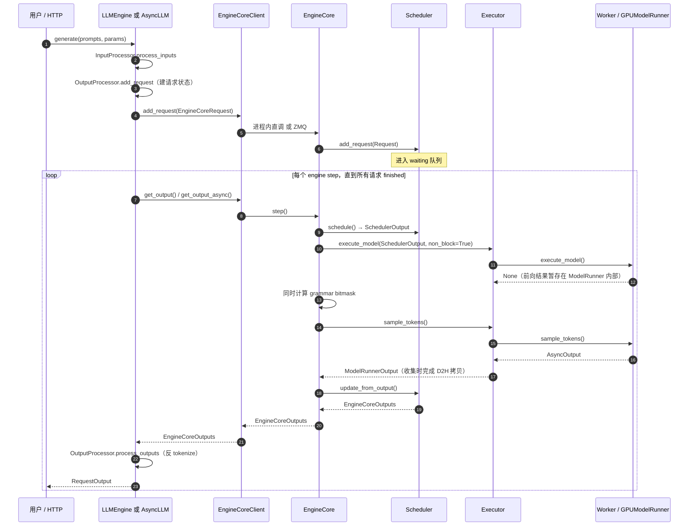
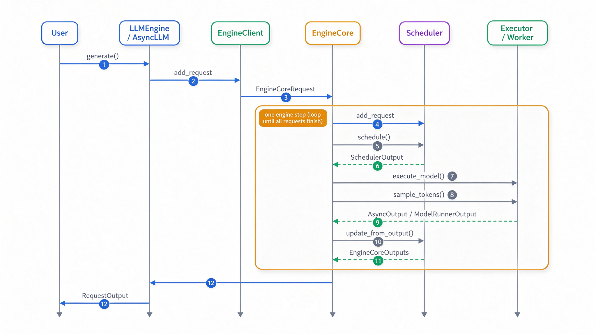
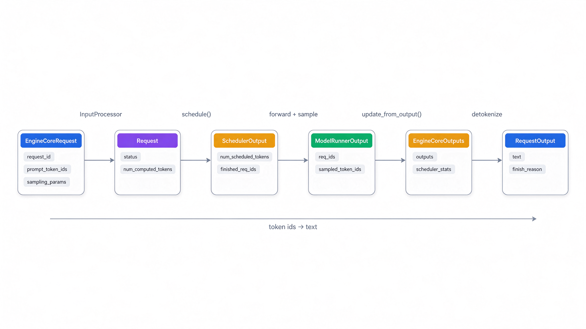
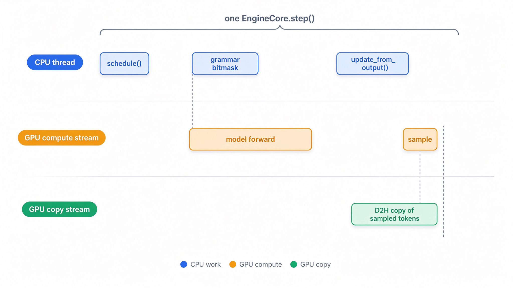

# 课时02 vLLM 架构总览与请求生命周期

> 版本锚点：`main@8c17e46`（2026-11）。
> 本文所有 `文件:行号` 都以该 commit 为准；代码块标题是片段起点，省略处用 `...` 标注。换分支后需要重新核对行号。
>
> 前置：完成课时01，能跑通 `LLM.generate` 和 `vllm serve`。
> 配图：5 张正文配图 + 1 张封面（`figures/02-00-cover.png`）已用 Seedream 5.5 生成；原始 prompt 保留在 `figures/PROMPTS.md`，可随时重生成。

## 0. 本节要解决什么

读完本节，你应该能：

1. 画出 vLLM v1 的分层结构和进程拓扑；
2. 不查代码说出一次 `generate` 依次经过哪些类；
3. 在源码里定位“调度 / 执行 / 采样 / 输出”任意一步；
4. 用一个 hook 脚本打印真实调用链。

**一句话结论**：vLLM v1 是一条四层流水线——前端（EngineClient）→ 引擎（EngineCore + Scheduler）→ 执行器（Executor）→ Worker/ModelRunner；一次请求的核心循环固定为 `schedule → execute_model → sample_tokens → update_from_output`。

## 1. 为什么要先看架构

`vllm/v1/` 大约 20 万行 Python。按目录从 `v1/core` 读到 `v1/worker`，很快就会淹没在细节里。更有效的顺序是：

1. 先找到“一个请求从进入到吐出 token”的主干；
2. 把每个功能（prefix caching、投机解码、PD 分离、CUDA Graph、DP/EP）挂到主干上；
3. 需要时再深入某个模块。

因为后面 18 节课的内容，全部是这条主干上的一个分支或一个加速器。先有主干，后面的源码才有位置可放。

## 2. 分层结构

| 层 | 职责 | 关键类 | 源码位置 |
|---|---|---|---|
| 入口层 | 解析 HTTP / Python 调用，模板渲染、tokenize | `LLM`、`OpenAIServingChat` | `vllm/entrypoints/llm.py`、`vllm/entrypoints/openai/chat_completion/serving.py` |
| 前端引擎 | 维护请求状态、组装 `EngineCoreRequest`、反 tokenize | `LLMEngine`、`AsyncLLM`、`InputProcessor`、`OutputProcessor` | `vllm/v1/engine/llm_engine.py`、`async_llm.py`、`input_processor.py`、`output_processor.py` |
| 引擎客户端 | 把请求送进 EngineCore，把输出取回来 | `InprocClient`、`SyncMPClient`、`AsyncMPClient` | `vllm/v1/engine/core_client.py` |
| 引擎核心 | 调度、组 batch、驱动执行、汇总输出 | `EngineCore`、`EngineCoreProc`、`Scheduler` | `vllm/v1/engine/core.py`、`vllm/v1/core/sched/scheduler.py` |
| 执行器 | 把 batch 分发到 worker，聚合结果 | `UniProcExecutor`、`MultiprocExecutor`、`RayExecutorV2` | `vllm/v1/executor/` |
| Worker / 模型执行 | KV cache、输入准备、forward、采样 | `Worker`、`GPUModelRunner` | `vllm/v1/worker/gpu_worker.py`、`vllm/v1/worker/gpu/model_runner.py` |



*图2-1：六层结构与请求/输出方向。Prompt 见 `figures/PROMPTS.md`。*

三个容易看错的点：

- **tokenize / detokenize 只在前端发生**。EngineCore 及其下游只认 token id，不认字符串。
- **EngineCore 先创建 Executor，再创建 Scheduler**。因为 Scheduler 需要先通过 profiling 拿到 KV cache 配置。见 `vllm/v1/engine/core.py:165` 和 `:190`。
- **Scheduler 没有独立的 prefill / decode 阶段**。它统一用 `num_computed_tokens` 追赶 `num_tokens_with_spec`，见 `scheduler.py:702` 的注释。

## 3. 进程拓扑

### 3.1 默认离线推理：2 个进程

`LLM` 默认走 `SyncMPClient`（`VLLM_ENABLE_V1_MULTIPROCESSING=1`），EngineCore 在独立进程；TP=1 时 executor 默认是 `uni`（`vllm/config/parallel.py:1317`），所以 Worker 和 ModelRunner 就在 EngineCore 进程里。



### 3.2 TP / PP > 1：再加 N 个 Worker 进程

executor 变成 `MultiprocExecutor`，由它 `spawn` 出多个 `WorkerProc`。EngineCore 进程只做调度和聚合，不持有模型。



### 3.3 在线服务：前端换成 AsyncLLM

`vllm serve` 的 API server 进程里是 `AsyncLLM` + `AsyncMPClient`，EngineCore 进程与上面相同。DP > 1 时，每个 DP rank 一个 EngineCore，另有一个 `DPCoordinator` 做请求波次协调。

另外，`EngineCoreProc` 内部有 3 个执行体：

- 主线程：`run_busy_loop`（`core.py:1814`）；
- 输入 IO 线程：`process_input_sockets`（`core.py:2198`），DEALER 收请求；
- 输出 IO 线程：`process_output_sockets`（`core.py:2305`），PUSH 发结果。



*图2-2：离线单卡、TP>1、在线 DP 三种进程拓扑。*

## 4. 一次请求的完整时序



离线与在线只有“怎么等结果”不同：

| | 离线 `LLM` | 在线 `AsyncLLM` |
|---|---|---|
| 客户端 | `SyncMPClient` | `AsyncMPClient` |
| 取结果 | `LLMEngine.step()` 同步 `get_output()` | 后台 `output_handler` 循环 `get_output_async()` |
| 输出去向 | `step()` 直接返回 list | 推入每个请求的 `RequestOutputCollector` 队列 |
| 结束条件 | `has_unfinished_requests()` | 请求级 async generator 结束 |



*图2-3：一次请求的端到端时序，虚线框内是 engine step 循环。*

## 5. 五种核心数据结构

看懂这五个结构，就看清了各层之间的契约。

| 结构 | 生产者 | 消费者 | 关键字段 | 源码 |
|---|---|---|---|---|
| `EngineCoreRequest` | 前端 `InputProcessor` | EngineCore | `request_id`、`prompt_token_ids`、`sampling_params`、`arrival_time`、`priority` | `vllm/v1/engine/__init__.py:175` |
| `Request` | `EngineCore.preprocess_add_request` | Scheduler | `status`、`num_computed_tokens`、`num_tokens_with_spec`、`max_tokens` | `vllm/v1/request.py:63` |
| `SchedulerOutput` | `Scheduler.schedule` | Executor / Worker | `scheduled_new_reqs`、`num_scheduled_tokens`、`total_num_scheduled_tokens`、`finished_req_ids` | `vllm/v1/core/sched/output.py:241` |
| `ModelRunnerOutput` | ModelRunner | Scheduler | `req_ids`、`sampled_token_ids`、`logprobs`、`kv_connector_output` | `vllm/v1/outputs.py:274` |
| `EngineCoreOutputs` | Scheduler `update_from_output` | 前端 `OutputProcessor` | `outputs`（`EngineCoreOutput` 列表）、`scheduler_stats`、`timestamp` | `vllm/v1/engine/__init__.py:343` |



*图2-4：五种结构之间的转换关系。*

转换链：

```text
prompt 文本
  └─ InputProcessor ──> EngineCoreRequest（token id）
        └─ Scheduler ──> Request（加入 waiting）
              └─ schedule() ──> SchedulerOutput（这一 step 算哪些 token）
                    └─ ModelRunner ──> ModelRunnerOutput（采样出的 token id）
                          └─ update_from_output() ──> EngineCoreOutputs
                                └─ OutputProcessor ──> RequestOutput（文本 + finish_reason）
```

## 6. 源码走读

### 6.1 离线入口：`generate` 只是“加请求 + 循环 step”

`LLM.generate`（`vllm/entrypoints/llm.py:427`）把工作交给 `OfflineInferenceMixin._run_completion`：

```python title="vllm/entrypoints/common/offline.py:340"
def _run_completion(self, prompts, params, output_type, *, use_tqdm=True, ...):
    self._add_completion_requests(...)
    return self._run_engine(use_tqdm=use_tqdm, output_type=output_type)
```

请求是“先全部入队，再统一推进”的：

```python title="vllm/entrypoints/common/offline.py:589"
outputs: list[_O] = []
while self.llm_engine.has_unfinished_requests():
    step_outputs = self.llm_engine.step()
    for output in step_outputs:
        if output.finished:
            outputs.append(output)
```

所以离线推理的“批处理”不是一次 forward 全做完，而是每一步由 Scheduler 重新组 batch。后面课时05会看到它怎么在 prefill 和 decode 之间分配 token budget。

### 6.2 请求进入引擎：两次对象转换

`LLMEngine.add_request`（`llm_engine.py:231`）先做输入处理，再把请求交给 EngineCore：

```python title="vllm/v1/engine/llm_engine.py:273"
request = self.input_processor.process_inputs(
    request_id,
    prompt,
    params,
    supported_tasks=self.get_supported_tasks(),
    arrival_time=arrival_time,
    lora_request=lora_request,
    tokenization_kwargs=tokenization_kwargs,
    trace_headers=trace_headers,
    priority=priority,
    session_id=session_id,
    kv_hints=kv_hints,
)
...
self.output_processor.add_request(request, prompt_text, None, 0)
self.engine_core.add_request(request)
```

注意 `output_processor.add_request`：前端在请求发出前就建好了输出侧状态（detokenizer、logprobs、队列）。这样 EngineCore 的第一条输出回来时，前端已经知道该往哪个请求上挂。

EngineCore 侧只做校验和转发：

```python title="vllm/v1/engine/core.py:566"
def add_request(self, request: Request, request_wave: int = 0):
    ...
    self.scheduler.add_request(request)
    if request.abort_immediately:
        self.abort_requests([request.request_id])
```

`Scheduler.add_request`（`scheduler.py:3112`）把请求放进 waiting 队列，并记录 `QUEUED` 事件。到这里，请求才真正进入调度系统。

### 6.3 一个 engine step：整条主干的缩影

```python title="vllm/v1/engine/core.py:714"
def step(self) -> tuple[dict[int, EngineCoreOutputs], bool]:
    if not self.scheduler.has_requests():
        return {}, False
    scheduler_output = self.scheduler.schedule(self._should_throttle_prefills())
    if scheduler_output.total_num_scheduled_tokens > 0:
        self.num_executed_steps += 1
    future = self.model_executor.execute_model(scheduler_output, non_block=True)
    grammar_output = self.scheduler.get_grammar_bitmask(scheduler_output)
    with self.log_error_detail(scheduler_output):
        model_output = self._wait_for_output(future)
        if model_output is None:
            model_output = self.model_executor.sample_tokens(grammar_output)
    ...
    engine_core_outputs = self.scheduler.update_from_output(
        scheduler_output, model_output
    )
    ...
    return engine_core_outputs, scheduler_output.total_num_scheduled_tokens > 0
```

这段代码有三个关键设计：

1. **`non_block=True`**：前向是异步提交的，CPU 可以去算 grammar bitmask，避免 GPU 空等。
2. **`execute_model` 可能返回 None**：当前实现里，负责采样的 rank（最后一个 PP rank；无 PP 时就是唯一 rank）只把 hidden states 暂存在 ModelRunner，不在 forward 里采样；采样由 `sample_tokens` 单独完成。
3. **`update_from_output` 负责“结算”**：把采样结果写回请求、判断停止条件、释放 KV block，并生成 `EngineCoreOutputs`。

PP 或 `max_concurrent_batches > 1` 时，`step_fn` 会切换到 `step_with_batch_queue`（`core.py:759`），用 batch queue 消 pipeline bubble。这是课时14的内容，这里先知道有这条分支即可。

### 6.4 调度：没有 prefill / decode 之分

`Scheduler.schedule`（`scheduler.py:702`）开头有一段非常重要的注释：

```python title="vllm/v1/core/sched/scheduler.py:702"
# NOTE(woosuk) on the scheduling algorithm:
# There's no "decoding phase" nor "prefill phase" in the scheduler.
# Each request just has the num_computed_tokens and
# num_tokens_with_spec. num_tokens_with_spec =
# len(prompt_token_ids) + len(output_token_ids) + len(spec_token_ids).
# At each step, the scheduler tries to assign tokens to the requests
# so that each request's num_computed_tokens can catch up its
# num_tokens_with_spec. This is general enough to cover
# chunked prefills, prefix caching, speculative decoding,
# and the "jump decoding" optimization in the future.
```

这句话解释了为什么 chunked prefill、prefix caching、投机解码可以共用一套调度逻辑：调度器只关心“这个请求还差多少 token 没算”，不关心它处于哪个“阶段”。

输出就是一个 `SchedulerOutput`：这一 step 每个请求算多少 token、哪些请求第一次进来、哪些请求结束了。

### 6.5 执行与采样：forward 和 sample 是分开的

`Executor.execute_model`（`vllm/v1/executor/abstract.py:307`）最终落到 `Worker.execute_model`（`gpu_worker.py:1513`），再到 `GPUModelRunner.execute_model`（`model_runner.py:1865`）：

```python title="vllm/v1/worker/gpu/model_runner.py:1865"
def execute_model(self, scheduler_output, intermediate_tensors=None, dummy_run=False, ...):
    if not dummy_run:
        self.draft_tokens_handler.begin_step(scheduler_output)
        # Update the request states.
        self.update_pp_decode_requests()
        self.finish_requests(scheduler_output)
        self.free_states(scheduler_output)
        self.add_requests(scheduler_output)
        self.update_requests(scheduler_output)
        ...
    ...
    input_batch = self.prepare_inputs(
        scheduler_output, batch_req_state, batch_desc, num_active_loras
    )
    block_tables, slot_mappings = self.prepare_attn(input_batch)
    ...
    model_output = self.model(**model_inputs)
    ...
    return None
```

上面省略了 CUDA Graph / compiled 分支：实际代码会按 `batch_desc.cg_mode` 在 `ubatch_runner.run`、`cudagraph_manager.run_pw_graph` 和 `self.model(...)` 之间选择。

`add_requests` / `update_requests` 维护的是“常驻请求状态”（类似 persistent batch）；`prepare_inputs` 每个 step 重新生成当步的输入张量。二者分离是 ModelRunner V2 的核心思路，课时20会展开。

采样在 `sample_tokens`（`model_runner.py:2279`）：

```python title="vllm/v1/worker/gpu/model_runner.py:2279"
def sample_tokens(self, grammar_output):
    if self.execute_model_state is None:
        return None
    ...
    sampler_output, num_sampled, num_rejected = self.sample(
        hidden_states, input_batch, grammar_output
    )
    ...
    async_output = AsyncOutput(
        model_runner_output=model_runner_output,
        sampler_output=sampler_output,
        ...
    )
    ...
    return async_output
```

`AsyncOutput` 把“GPU 上的 sampled token id”异步拷贝到 host。真正的同步发生在 Executor 收集结果时：

```python title="vllm/v1/executor/multiproc_executor.py:1131"
def enqueue_output(self, output: Any):
    if isinstance(output, AsyncModelRunnerOutput):
        try:
            output = output.get_output()
        except Exception as e:
            ...
```

```python title="vllm/v1/worker/gpu/async_utils.py:192"
def get_output(self) -> ModelRunnerOutput:
    self.copy_event.synchronize()
    ...
```

所以“采样”有两层含义：`sample_tokens` 发起采样和异步拷贝，`get_output` 等待拷贝完成并转成 `ModelRunnerOutput`。调试时如果看到 GPU 空等，要区分是 forward 慢、采样慢，还是 D2H 拷贝慢。



*图2-5：CPU 调度、GPU forward、采样与 D2H 拷贝的重叠关系。*

### 6.6 输出：反 tokenize 在前端

EngineCore 返回的是 token id：

```python title="vllm/v1/engine/__init__.py:275"
class EngineCoreOutput(...):
    request_id: str
    new_token_ids: list[int]
    finish_reason: FinishReason | None = None
    ...
```

前端 `OutputProcessor.process_outputs`（`output_processor.py:731`）负责遍历整个 batch：

```python title="vllm/v1/engine/output_processor.py:731"
def process_outputs(self, engine_core_outputs, engine_core_timestamp=None, ...):
    """Process the EngineCoreOutputs:
    1) Compute stats for logging
    2) Detokenize
    3) Create and handle RequestOutput objects:
        * If there is a queue (for usage with AsyncLLM),
          put the RequestOutput objects into the queue ...
    """
    request_outputs = []
    reqs_to_abort = []
    for engine_core_output in engine_core_outputs:
        ...
```

这段 docstring 里有一句设计约束：**vLLM v1 尽量减少对全 batch 的 Python 循环，而这里是唯一应该遍历 `EngineCoreOutputs` 的地方**。以后读其他模块时，如果看到每个请求都做一次重活，就要警惕。

## 7. 最小实验：打印真实调用链

### 7.1 脚本

把下面的代码保存为 `lesson/02-architecture/code/trace_lifecycle.py`：

```python
import functools
import os

# 关键：把 EngineCore 留在当前进程，否则 hook 打不进去。
os.environ.setdefault("VLLM_ENABLE_V1_MULTIPROCESSING", "0")

import time

from vllm import LLM, SamplingParams
from vllm.v1.core.sched.scheduler import Scheduler
from vllm.v1.engine.core import EngineCore
from vllm.v1.engine.llm_engine import LLMEngine
from vllm.v1.worker.gpu.model_runner import GPUModelRunner

state = {"depth": 0, "enabled": False}


def hook(cls, name, label, describe=None):
    original = getattr(cls, name)

    @functools.wraps(original)
    def wrapper(*args, **kwargs):
        if not state["enabled"]:
            return original(*args, **kwargs)

        indent = "  " * state["depth"]
        detail = describe(args, kwargs) if describe else ""
        print(f"{indent}-> {label} {detail}")
        state["depth"] += 1
        start = time.perf_counter()
        try:
            return original(*args, **kwargs)
        finally:
            state["depth"] -= 1
            elapsed = (time.perf_counter() - start) * 1000
            print(f"{indent}<- {label} {elapsed:.2f} ms")

    setattr(cls, name, wrapper)


hook(LLMEngine, "step", "LLMEngine.step")
hook(EngineCore, "step", "EngineCore.step")
hook(
    Scheduler,
    "schedule",
    "Scheduler.schedule",
    lambda a, k: f"// throttle_prefills={a[1] if len(a) > 1 else k.get('throttle_prefills')}",
)
hook(Scheduler, "update_from_output", "Scheduler.update_from_output")
hook(GPUModelRunner, "execute_model", "GPUModelRunner.execute_model",
     lambda a, k: f"scheduled_tokens={a[1].total_num_scheduled_tokens}")
hook(GPUModelRunner, "sample_tokens", "GPUModelRunner.sample_tokens")


def main():
    llm = LLM(
        model="facebook/opt-125m",
        max_model_len=256,
        enforce_eager=True,      # 关掉 CUDA Graph / torch.compile，日志更干净
        gpu_memory_utilization=0.3,
    )
    params = SamplingParams(max_tokens=4, temperature=0)

    state["enabled"] = True     # 忽略初始化阶段的 dummy run
    outputs = llm.generate(["Hello, my name is"], params)
    state["enabled"] = False

    print("\n=== final output ===")
    print(outputs[0].outputs[0].text)


if __name__ == "__main__":
    main()
```

### 7.2 运行

```bash
VLLM_ENABLE_V1_MULTIPROCESSING=0 .venv/bin/python \
  lesson/02-architecture/code/trace_lifecycle.py
```

需要一张能跑 vLLM 的 GPU。`facebook/opt-125m` 约 250 MB，首次运行会从 HuggingFace 下载。

### 7.3 预期输出与解读

输出形如（只画出一个 step，耗时因机器而异）：

```text
-> LLMEngine.step
  -> EngineCore.step
    -> Scheduler.schedule // throttle_prefills=False
    <- Scheduler.schedule 0.08 ms
    -> GPUModelRunner.execute_model scheduled_tokens=<prompt_len>
    <- GPUModelRunner.execute_model 12.41 ms
    -> GPUModelRunner.sample_tokens
    <- GPUModelRunner.sample_tokens 0.62 ms
    -> Scheduler.update_from_output
    <- Scheduler.update_from_output 0.11 ms
  <- EngineCore.step 14.02 ms
<- LLMEngine.step 14.35 ms
```

第一轮的 `scheduled_tokens` 等于 prompt 的 token 数（`<prompt_len>`，取决于 tokenizer），这一轮是 prefill，同时采出第一个输出 token。后续几轮 `scheduled_tokens=1`，是 decode。默认配置下通常是 4 轮，对应 `max_tokens=4`。

把日志和 6.3 的 `EngineCore.step` 对照，可以看到每个框对应一行源码。你也可以把 `describe` 改成打印 `scheduler_output.num_scheduled_tokens`，观察 batch 的变化。

## 8. 调试与观测入口

| 想看什么 | 用什么 |
|---|---|
| 每个 step 的调度明细 | `ObservabilityConfig.enable_logging_iteration_details` |
| 每个 step 的耗时分解 | `vllm/v1/metrics/perf.py` |
| 每个请求的耗时 | `--enable-per-request-metrics`（见 `docs/features/per_request_metrics.md`） |
| 函数级调用链 | `VLLM_TRACE_FUNCTION=1`（很重，只用于卡死/崩溃） |
| GPU kernel 时间线 | 课时19 的 Torch Profiler / Nsight Systems |
| 单进程断点 | `VLLM_ENABLE_V1_MULTIPROCESSING=0` + `pdb` |

## 9. 常见误区

1. **以为 `execute_model` 返回采样结果**。当前实现里负责采样的 rank（最后一个 PP rank；无 PP 时就是唯一 rank）返回 `None`，采样在 `sample_tokens`；`AsyncOutput` 的 D2H 拷贝在 executor 收集时才同步。
2. **以为 Scheduler 分 prefill / decode 两个阶段**。它只有 token budget 和 `num_computed_tokens`，chunked prefill、投机解码都是同一个循环的特例。
3. **以为 `LLM` 是单进程**。默认是 2 个进程（前端 + EngineCore）；TP/PP > 1 时还有 N 个 worker。hook 前必须关掉多进程。
4. **以为输出处理在 EngineCore**。反 tokenize、stopping string、logprobs 组装都在前端 `OutputProcessor`。
5. **以为 EngineCore 先建 Scheduler**。它先建 Executor 并 profiling 显存，再建 Scheduler；所以调度器的 `block_size` 和 KV cache 配置来自 worker。

## 10. 自检 5 问

1. 一次 `LLM.generate` 默认跨几个进程？TP=2 时呢？
2. `SchedulerOutput` 是谁生产的、谁消费的？
3. 为什么 `EngineCore.step` 里 `execute_model` 之后还要判断 `model_output is None`？
4. `EngineCoreOutputs` 里的 `new_token_ids` 在哪里变成文本？
5. 如果要把 prefix caching 的命中率打出来，应该改哪一层？

参考答案：

1. 默认 2 个（前端 + EngineCore）；TP=2 时再加 2 个 worker，共 4 个。
2. `Scheduler.schedule` 生产，Executor / Worker 消费。
3. 当前实现把 forward 和采样拆开：`execute_model` 只做前向并把状态暂存，返回 `None` 时由 `sample_tokens` 采样。
4. 前端 `OutputProcessor.process_outputs`，内部用 `IncrementalDetokenizer`。
5. 调度器层（`Scheduler._get_local_prefix_cache_hit` / `KVCacheManager` 的 prefix cache stats），不是 OutputProcessor。

## 11. 延伸阅读

- `docs/design/arch_overview.md`：官方架构总览
- `docs/design/multiprocessing.md`：多进程与调试
- `docs/design/shm_tensor_arena.md`：EngineCore → Worker 的零拷贝 IPC
- `vllm/v1/engine/core_client.py`：三种 client 的 docstring
- 下一课：课时03 会把本节一笔带过的 ZMQ 通信和 `AsyncLLM` 输出循环拆开讲。
