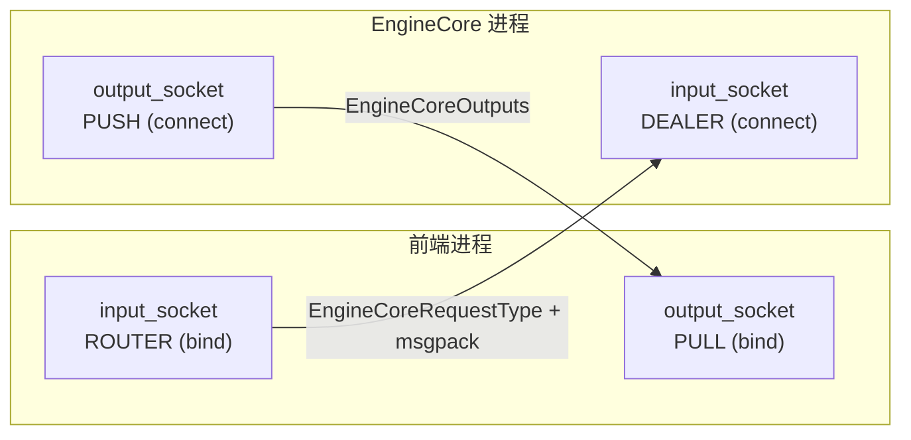
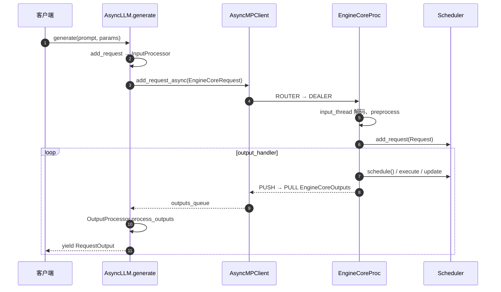

# 课时03 vLLM 核心组件：EngineCore 与流式执行

> 版本锚点：`main@8c17e46`。代码块标题是片段起点，省略处用 `...` 标注。
>
> 前置：课时02。你需要知道一次请求的主干是 `schedule → execute_model → sample_tokens → update_from_output`。

## 0. 本节要解决什么

1. 为什么 EngineCore 要跑在独立进程；
2. vLLM 实际用了哪几种 ZMQ 通信模式；
3. 五种 EngineClient 分别在什么场景使用；
4. AsyncLLM 如何把 EngineCore 的批式输出拆成每个请求的流式输出。

**一句话结论**：EngineCore 是一个“三线程 + 两个队列”的批处理循环；前端通过 `ROUTER/DEALER` 发请求、通过 `PUSH/PULL` 收结果；AsyncLLM 用后台 `output_handler` 把 `EngineCoreOutputs` 解包并推入每个请求的队列。

## 1. 为什么要把 EngineCore 拆出去

三个直接原因：

1. **绕过 GIL**：前端要做 tokenize、模板渲染、detokenize、HTTP 序列化，这些是 Python 密集操作；EngineCore 要连续跑调度和 GPU 提交。拆成两个进程后，两者可以真正并行。
2. **故障隔离**：API server 崩了不应该带走正在跑的模型；EngineCore 崩了，前端可以明确返回 `EngineDeadError`，而不是静默挂住。
3. **多前端复用**：一个 EngineCore 可以接多个 API server 进程；DP 场景下也可以由 Coordinator 统一分发。

代价是跨进程通信。vLLM 选择 ZMQ + msgpack，而不是 HTTP/gRPC，原因是：

- ZMQ 的 DEALER/ROUTER 天然支持多客户端、多引擎、重连；
- PUSH/PULL 适合单向输出，不需要请求-响应配对；
- msgpack 足够快，且能配合零拷贝（OOB）传张量。

## 2. ZMQ 通信模式

| 模式 | 语义 | 典型用途 | vLLM 是否使用 |
|---|---|---|---|
| REQ/REP | 同步一问一答，严格配对 | 简单的 RPC | 仅少量辅助链路（如 EC transfer） |
| DEALER/ROUTER | 异步多对一，带 identity | 前端 → 引擎发请求 | **主输入链路** |
| PUSH/PULL | 单向负载均衡 | 引擎 → 前端发结果 | **主输出链路** |
| PAIR | 一对一 | 关闭握手、进程内通知 | **shutdown 握手** |
| PUB/SUB | 广播 | 指标、事件 | DP 协调器使用 XPUB/XSUB |

实际拓扑（注意方向）：



为什么输入用 ROUTER/DEALER 而不是 REQ/REP：ROUTER 可以在一个 socket 上接多个 DEALER（多 API server、多 DP rank），并且能通过 identity 把回复路由回正确的客户端。REQ/REP 的严格状态机会让重连和异步发送变得很难。

源码位置：

- 前端建 socket：`vllm/v1/engine/core_client.py:688`（ROUTER）和 `:695`（PULL）；
- 引擎建 socket：`vllm/v1/engine/core.py:2216`（DEALER）和 `:2324`（PUSH）。

## 3. 五种 EngineClient

`EngineCoreClient.make_client`（`core_client.py:111`）按“是否多进程 / 是否 asyncio / 是否 DP”分派：

| 类 | 场景 | 关键行为 | 源码 |
|---|---|---|---|
| `InprocClient` | 单进程调试、`VLLM_ENABLE_V1_MULTIPROCESSING=0` | 直接调 `EngineCore.step` | `core_client.py:392` |
| `SyncMPClient` | 离线 `LLM` 默认 | 后台进程 + 同步 `get_output` | `core_client.py:988` |
| `AsyncMPClient` | 在线 `AsyncLLM` | 后台进程 + asyncio 输出队列 | `core_client.py:1184` |
| `DPAsyncMPClient` | DP + 外部负载均衡 | 每个 DP rank 一个 client | `core_client.py:1541` |
| `DPLBAsyncMPClient` | DP + 内部负载均衡 | 客户端按 wave 分发请求 | `core_client.py:1780` |

这五种客户端对上层暴露同一组方法：`add_request`、`get_output` / `get_output_async`、`abort_requests`、`profile`、`sleep` 等。上层 `LLMEngine` / `AsyncLLM` 不需要知道自己用的是哪一种。

## 4. EngineCoreProc：三线程 + 两个队列

`EngineCoreProc`（`core.py:1341`）是 `EngineCore` 的 ZMQ 外壳。它在 `__init__` 里启动两个 daemon 线程：

```python title="vllm/v1/engine/core.py:1436"
input_thread = threading.Thread(
    target=self.process_input_sockets,
    args=(addresses.inputs, addresses.coordinator_input, identity, ready_event),
    daemon=True,
)
input_thread.start()

self.output_thread = threading.Thread(
    target=self.process_output_sockets,
    args=(addresses.outputs, addresses.coordinator_output, self.engine_index),
    daemon=True,
)
self.output_thread.start()
```

三个执行体的分工：

| 执行体 | 职责 | 通信对象 |
|---|---|---|
| 主线程 `run_busy_loop` | 取 input_queue、调 `step`、把结果放 output_queue | Python queue |
| 输入线程 `process_input_sockets` | DEALER 收包、msgpack 解码、预处理、入 input_queue | ZMQ ↔ queue |
| 输出线程 `process_output_sockets` | 从 output_queue 取结果、msgpack 编码、PUSH 发送 | queue ↔ ZMQ |

主循环本身很短：

```python title="vllm/v1/engine/core.py:1814"
def run_busy_loop(self):
    """Core busy loop of the EngineCore."""
    while self._handle_shutdown():
        # 1) Poll the input queue until there is work to do.
        self._process_input_queue()
        self._maybe_publish_request_counts()
        # 2) Step the engine core and return the outputs.
        self._process_engine_step()
        self._maybe_publish_request_counts()
    raise SystemExit
```

`_process_input_queue` 在没有工作时会阻塞在 `input_queue.get(block=True)`；有请求后，`_process_engine_step` 调 `self.step_fn()`，把 `EngineCoreOutputs` 放进 `output_queue`。这就是“引擎永远在跑”的来源：它不是被 HTTP 请求驱动的，而是被一个常驻循环驱动的。

输入线程收到 `ADD` 后，会在入队前把 `EngineCoreRequest` 转成调度器用的 `Request`（`preprocess_add_request`，`core.py:1271`）。这一步包括多模态特征、watermark、structured output grammar 的初始化。

## 5. 流式执行：AsyncLLM 如何拆包

`AsyncLLM.generate`（`async_llm.py:740`）本身不做调度，它只做三件事：

1. `await self.add_request(...)` 拿到一个 `RequestOutputCollector`（每个请求一个队列）；
2. 后台任务 `output_handler` 持续从 `AsyncMPClient.get_output_async()` 拉 `EngineCoreOutputs`；
3. `generate` 从自己的 collector 里取 `RequestOutput`，yield 给调用方。

`output_handler` 的形状：

```python title="vllm/v1/engine/async_llm.py:890"
async def output_handler():
    try:
        while True:
            # 1) Pull EngineCoreOutputs from the EngineCore.
            outputs = await engine_core.get_output_async()
            num_outputs = len(outputs.outputs)
            ...
            # 2) Process EngineCoreOutputs.
            processed_outputs = output_processor.process_outputs(
                outputs_slice,
                outputs.timestamp,
                iteration_stats,
                weight_version=outputs.weight_version,
            )
            # NOTE: RequestOutputs are pushed to their queues.
            assert not processed_outputs.request_outputs
            ...
```

注意 `VLLM_V1_OUTPUT_PROC_CHUNK_SIZE`：一次 `EngineCoreOutputs` 可能包含上千个请求，`output_handler` 会按 chunk 处理并 `await asyncio.sleep(0)`，避免长时间占用事件循环。

`AsyncMPClient.get_output_async` 只是从 `outputs_queue` 取数据：

```python title="vllm/v1/engine/core_client.py:1305"
async def get_output_async(self) -> EngineCoreOutputs:
    self._ensure_output_queue_task()
    assert self.outputs_queue is not None
    outputs = await self.outputs_queue.get()
    if isinstance(outputs, Exception):
        raise self._format_exception(outputs) from None
    return outputs
```

真正的 socket 接收在 `process_outputs_socket` 这个后台 asyncio task 里（`core_client.py:1249` 起）。它把 ZMQ 的 PULL 结果解码成 `EngineCoreOutputs`，再放进 `outputs_queue`。

## 6. 一次请求从进入到第一帧输出



这里有两个“队列”容易混淆：

- **EngineCore 进程内的 `input_queue` / `output_queue`**：Python `queue.Queue`，连接 IO 线程和主循环；
- **前端进程内的 `outputs_queue`**：asyncio `Queue`，连接 socket 接收 task 和 `get_output_async`。

## 7. 最小实验：看进程和 socket

### 7.1 打印 EngineCore 进程

```python
import os

from vllm import LLM, SamplingParams

llm = LLM(model="facebook/opt-125m", enforce_eager=True, max_model_len=256)
client = llm.llm_engine.engine_core
print("frontend pid:", os.getpid())
print("engine pids:", [p.pid for p in client.resources.engine_manager.processes])

llm.generate(["Hello"], SamplingParams(max_tokens=2))
```

运行后应该看到两个不同的 PID。把 `VLLM_ENABLE_V1_MULTIPROCESSING` 设为 `0`，客户端会变成 `InprocClient`，没有 `resources.engine_manager`，因为 EngineCore 回到了当前进程。

### 7.2 看 ZMQ socket

```bash
# 终端 1
vllm serve facebook/opt-125m --enforce-eager --max-model-len 256

# 终端 2
ss -xp | grep -i vllm
# 或
lsof -p "$(pgrep -f 'EngineCore' | head -1)" | grep -i zmq
```

能看到成对的 `ipc://` 或 `tcp://` endpoint。ROUTER/DEALER 与 PUSH/PULL 的地址在启动日志里也会打印。

## 8. 常见误区

1. **以为 EngineCore 是“每个请求一个线程”**。它是一个常驻单线程循环，所有请求共享同一个 step。
2. **以为 PUSH/PULL 可以反向发请求**。PUSH 是单向的；中止请求走的是输入链路（`ABORT`），不是输出链路。
3. **以为 AsyncLLM 自己跑模型**。它在前端进程，只做输入处理、输出拆包和流式转发。
4. **以为 `get_output_async` 直接读 socket**。它读的是 `outputs_queue`，真正的 socket 接收在后台 task。
5. **以为 DP 客户端只是多开几个 socket**。`DPLBAsyncMPClient` 还要维护 request wave，确保同一批请求落在同一波引擎上。

## 9. 自检 5 问

1. 前端发请求、收结果分别用什么 socket 类型？
2. `EngineCoreProc` 为什么需要输入线程和输出线程，而不是在主循环里直接读写 ZMQ？
3. `InprocClient` 和 `SyncMPClient` 的 `get_output` 行为差在哪？
4. AsyncLLM 的 `output_handler` 为什么要把输出按 chunk 处理？
5. DP 场景下，`DPAsyncMPClient` 和 `DPLBAsyncMPClient` 的区别是什么？

参考答案：

1. 发：前端 ROUTER、引擎 DEALER；收：引擎 PUSH、前端 PULL。
2. ZMQ 收发会阻塞；放到独立线程后，主循环可以持续调度，IO 与 GPU step 重叠。
3. `InprocClient` 直接调用 `EngineCore.step`；`SyncMPClient` 通过 ZMQ 发送并等待后台进程结果。
4. 一次输出可能覆盖上千请求，长时间占用事件循环会拖慢其他协程；分 chunk 并主动让出。
5. 前者每个 DP rank 一个 client（外部 LB）；后者一个 client 内部按 wave 分发到多个引擎（内部 LB）。

## 10. 延伸阅读

- `vllm/v1/engine/core_client.py` 顶部三个类的 docstring；
- `vllm/v1/engine/core.py:1341` `EngineCoreProc` 的 handshake；
- `docs/design/multiprocessing.md`；
- 下一课：课时04 进入 Executor 和 Worker，看 `SchedulerOutput` 如何变成 GPU 上的一次 forward。
