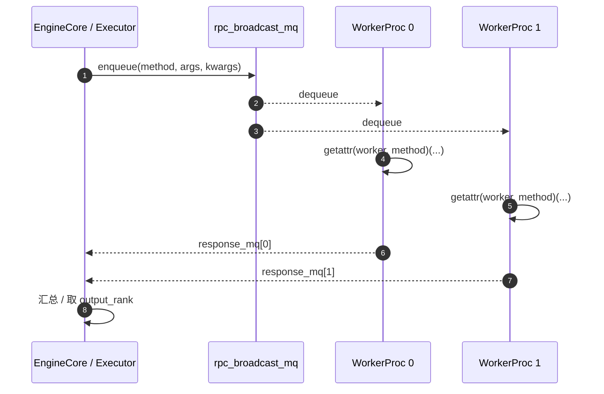

# 课时04 vLLM 核心组件：Worker / Executor 详解及协作

> 版本锚点：`main@8c17e46`。代码块标题是片段起点，省略处用 `...` 标注。

## 0. 本节要解决什么

1. Executor 的三种实现怎么选；
2. Worker 进程启动时按什么顺序做初始化；
3. `collective_rpc` 到底把调用发给了谁；
4. 为什么很多“Worker 方法”在引擎进程里也能直接调。

**一句话结论**：Executor 是 batch 的分发器，Worker 是模型和 KV cache 的宿主；两者之间只有一条通道——`collective_rpc`，底层是共享内存消息队列的广播 + 汇总。

## 1. 为什么需要 Executor 这一层

如果没有 Executor，EngineCore 就要自己处理：

- 单卡：直接持有 Worker；
- 多卡 TP/PP：spawn 进程、建立进程组、广播输入、汇总输出、处理某个 worker 挂掉；
- Ray：把同样的逻辑搬到 Ray actor 上；
- 外部 torchrun：worker 由外部启动，Executor 只负责握手。

这些都是“怎么把一次 `execute_model` 放到 N 个 Worker 上”的问题，和调度、KV cache 无关。抽成 Executor 后，EngineCore 只需要面对一个接口：

```python title="vllm/v1/executor/abstract.py:307"
def execute_model(
    self, scheduler_output: SchedulerOutput, non_block: bool = False
) -> ModelRunnerOutput | None | Future[ModelRunnerOutput | None]:
    output = self.collective_rpc(
        "execute_model", args=(scheduler_output,), non_block=non_block
    )
    return output[0]
```

## 2. Executor 家族

`Executor.get_class`（`abstract.py:66`）根据 `distributed_executor_backend` 选择实现：

| 实现 | 触发条件 | 进程模型 | 源码 |
|---|---|---|---|
| `UniProcExecutor` | TP=PP=1，默认 | Worker 与 EngineCore 同进程 | `uniproc_executor.py:51` |
| `MultiprocExecutor` | TP/PP>1，默认 | EngineCore + N 个 `WorkerProc` | `multiproc_executor.py:150` |
| `RayExecutorV2` | `--distributed-executor-backend ray` | 每个 Worker 一个 Ray actor | `ray_executor_v2.py:239` |
| `ExecutorWithExternalLauncher` | `external_launcher` / torchrun | Worker 由外部进程启动 | `uniproc_executor.py:161` |

选择逻辑的关键一行：

```python title="vllm/v1/executor/abstract.py:82"
elif distributed_executor_backend == "mp":
    from vllm.v1.executor.multiproc_executor import MultiprocExecutor
    executor_class = MultiprocExecutor
elif distributed_executor_backend == "uni":
    from vllm.v1.executor.uniproc_executor import UniProcExecutor
    executor_class = UniProcExecutor
```

TP=1 时默认是 `uni`，所以离线单卡只有一个 EngineCore 进程，Worker 和 ModelRunner 都在里面。TP>1 时默认是 `mp`，EngineCore 进程不再持有模型。

## 3. Worker 启动顺序

`WorkerProc.__init__`（`multiproc_executor.py:783`）里，顺序是固定的：

```python title="vllm/v1/executor/multiproc_executor.py:783"
wrapper = WorkerWrapperBase(rpc_rank=local_rank, global_rank=rank)
...
wrapper.init_worker(all_kwargs)
self.worker = wrapper
...
self.worker.init_device()
...
self.worker.load_model()
...
self._init_message_queues(input_shm_handle, vllm_config)
```

完整顺序（以 `GPUWorker` 为例）：

| 步骤 | 方法 | 做什么 | 源码 |
|---|---|---|---|
| 1 | `init_device` | 绑定 GPU、初始化分布式进程组、设置随机种子 | `gpu_worker.py:482` |
| 2 | `load_model` | 构建模型、加载权重、初始化 ModelRunner | `gpu_worker.py:637` |
| 3 | `determine_available_memory` | dummy run + profile，算出 KV cache 可用显存 | `gpu_worker.py:724` |
| 4 | `initialize_from_config` | 按 `KVCacheConfig` 分配 block、建 block table | `gpu_worker.py:938` |
| 5 | `compile_or_warm_up_model` | torch.compile、CUDA Graph 捕获、warmup | `gpu_worker.py:1068` |

注意第 3 步：**KV cache 的显存是在模型加载之后、由 Worker 实测出来的**，不是 EngineCore 拍脑袋算的。所以 EngineCore 必须等 Executor 初始化完，才能创建 Scheduler。

## 4. collective_rpc：广播 + 汇总

`MultiprocExecutor.collective_rpc`（`multiproc_executor.py:472`）做三件事：

1. 把 `(method, args, kwargs, output_rank)` 放进 `rpc_broadcast_mq`；
2. 每个 `WorkerProc` 从自己的队列里取出并执行；
3. Executor 从每个 worker 的 `response_mq` 收结果，按需聚合。

Worker 侧是一个死循环：

```python title="vllm/v1/executor/multiproc_executor.py:1189"
def worker_busy_loop(self):
    """Main busy loop for Multiprocessing Workers."""
    assert self.rpc_broadcast_mq is not None
    while True:
        with get_watch_dog().disable():
            rpc_request = self.rpc_broadcast_mq.dequeue(indefinite=True)
        self._execute_worker_rpc(rpc_request)
        del rpc_request
```

`_execute_worker_rpc` 支持两种 method：

- 字符串：`getattr(self.worker, method)`，调用 Worker 上的同名方法；
- bytes：cloudpickle 反序列化出的可调用对象，用于传 lambda / 闭包。

返回值通过 `handle_output` 放进 `worker_response_mq`。异常也会被捕获并作为 FAILURE 响应发回，EngineCore 再抛出。



几个容易忽略的细节：

- `collective_rpc` 默认返回 **list**，每个 worker 一个结果；只有传 `unique_reply_rank` 或聚合器时才返回单值。
- `execute_model` 传 `non_block=True` 时返回 `Future`，EngineCore 可以先算 grammar bitmask，再 `wait`。
- `UniProcExecutor` 没有消息队列，直接 `run_method(self.driver_worker, ...)`，所以调用栈更短、调试更简单。
- `WorkerWrapperBase.__getattr__` 会把未知属性转发给内部 `self.worker`，所以 `collective_rpc("get_model_inspection")` 能直接调到 `WorkerBase.get_model_inspection`。

## 5. 源码走读：一次 Worker 初始化

`WorkerWrapperBase.init_worker`（`worker_base.py:303`）负责“延迟实例化”：

```python title="vllm/v1/worker/worker_base.py:303"
def init_worker(self, all_kwargs: list[dict[str, Any]]) -> None:
    kwargs = all_kwargs[self.rpc_rank]
    vllm_config = kwargs.get("vllm_config")
    ...
    vllm_config.enable_trace_function_call_for_thread()
    ...
    worker_class = resolve_obj_by_qualname(parallel_config.worker_cls)
    self.worker = worker_class(**kwargs)
```

为什么要先构造 `WorkerWrapperBase` 再 `init_worker`：父进程 fork/spawn 时不能带着 CUDA context；worker 的构造必须发生在子进程里。`all_kwargs` 是一个 list，每个 rank 只取自己那份，这样同一个入口可以服务所有 rank。

`GPUWorker.init_device` 里最关键的是分布式初始化：

```python title="vllm/v1/worker/gpu_worker.py:482"
def init_device(self):
    ...
    init_worker_distributed_environment(
        self.vllm_config,
        self.rank,
        self.distributed_init_method,
        self.local_rank,
        current_platform.dist_backend,
    )
    ...
```

这一步建立 TP/PP/DP/EP 进程组，后面的 `all_reduce`、`all_to_all`、`send/recv` 都依赖它。如果这里失败，通常会在 `torch.distributed` 的 init 阶段看到 NCCL 超时。

## 6. 最小实验：直接调 Worker

因为 `UniProcExecutor` 和 EngineCore 同进程，可以绕过 HTTP，直接对 Worker 做 RPC：

```python
import os

os.environ["VLLM_ENABLE_V1_MULTIPROCESSING"] = "0"

from vllm import LLM

llm = LLM(
    model="facebook/opt-125m",
    enforce_eager=True,
    max_model_len=256,
    gpu_memory_utilization=0.3,
)
core = llm.llm_engine.engine_core.engine_core  # InprocClient.engine_core
executor = core.model_executor

print("executor:", type(executor).__name__)
print("workers:", len(executor.collective_rpc("determine_available_memory")))
print(executor.collective_rpc("get_model_inspection")[0][:800])
```

预期输出：

```text
executor: UniProcExecutor
workers: 1
OPTForCausalLM(
  (model): OPTModel(
    (decoder): OPTDecoder(
      ...
```

把 `tensor_parallel_size=2` 再跑一次，`workers` 会变成 2，`get_model_inspection` 返回两个字符串。这时 Executor 是 `MultiprocExecutor`，RPC 走消息队列。

## 7. 常见误区

1. **把 `Worker` 当成一个线程**。TP>1 时它是独立进程；崩溃会通过 death pipe / response 状态传回 Executor。
2. **以为 `collective_rpc` 只发给 driver**。默认广播给所有 worker，返回值是 list；只想取一个 rank 的结果要显式指定。
3. **以为 KV cache 在模型加载前分配**。顺序是 `load_model → determine_available_memory → initialize_from_config`。
4. **在 fork 之前初始化 CUDA**。vLLM 用 spawn/fork 的时机很讲究；自己写扩展时不要在父进程碰 CUDA。
5. **以为 Ray executor 是另一套 Worker**。它复用了 `WorkerProc` 的逻辑，只是把进程换成 Ray actor。

## 8. 自检 5 问

1. TP=1 和 TP=2 时，Executor 分别是什么？进程数各是多少？
2. `WorkerProc` 的启动顺序中，哪一步决定了 KV cache 的 block 数量？
3. `collective_rpc` 的返回值为什么默认是 list？
4. `UniProcExecutor` 为什么不需要消息队列？
5. 如果某个 worker 在 `execute_model` 里抛异常，EngineCore 会看到什么？

参考答案：

1. TP=1：`UniProcExecutor`，前端 + EngineCore 两个进程；TP=2：`MultiprocExecutor`，前端 + EngineCore + 2 个 Worker，共 4 个。
2. `determine_available_memory` 通过 dummy run/profile 测出可用显存，EngineCore 据此算 `num_gpu_blocks`。
3. 因为 RPC 默认广播到所有 worker，每个 worker 都有一个结果；调用方按 rank 取或聚合。
4. 它在同一个进程里直接持有 `driver_worker`，直接调用即可。
5. Executor 把异常作为 FAILURE 响应收回并抛出；如果启用了 fault tolerance，还会走失败回调。

## 9. 延伸阅读

- `vllm/v1/executor/multiproc_executor.py` 顶部注释与 `WorkerProc`；
- `vllm/distributed/device_communicators/shm_broadcast.py`：`MessageQueue` 的共享内存实现；
- `vllm/v1/worker/startup_plan.py`：启动计划缓存；
- 下一课：课时05 进入 Scheduler，看 `SchedulerOutput` 是怎么被算出来的。
