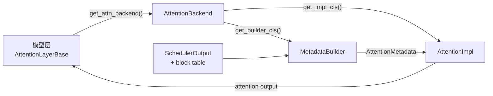

# 课时08 vLLM 核心组件：Attention 后端与内核实现

> 版本锚点：`main@8c17e46`。代码块标题是片段起点，省略处用 `...` 标注。

## 0. 本节要解决什么

1. 一个 attention backend 由哪三部分组成；
2. vLLM 如何为每一层选择后端；
3. MLA / 稀疏 attention / DCP 分别改变了什么；
4. 怎么在运行时打印当前模型实际用了哪些后端。

**一句话结论**：vLLM 把 attention 抽象成 `Backend + MetadataBuilder + Impl` 三段式；Backend 负责声明能力和选择 kernel，Builder 负责把 block table 变成 kernel 需要的 metadata，Impl 负责真正的 forward。

## 1. 为什么 attention 需要单独抽象

同一个模型，在不同硬件、不同 dtype、不同 KV cache 布局下，最优 attention kernel 完全不同：

- A100 上可能是 FlashAttention-2；
- H100 上可能是 FlashInfer / TRT-LLM；
- MLA 模型需要专门的 MLA kernel；
- 稀疏 attention 需要 indexer + sparse kernel；
- 滑窗 / Mamba 需要不同的 KV 管理策略；
- CUDA Graph 对 metadata 的形状有额外约束。

如果把这些 `if/else` 写进模型层，模型代码会不可维护。vLLM 的做法是：模型只声明“我要一个 attention”，后端在运行时决定“用哪个 kernel、怎么组织 KV”。

## 2. 三段式契约

| 角色 | 职责 | 关键方法 | 源码 |
|---|---|---|---|
| `AttentionBackend` | 声明能力、给出 Impl/Builder 类 | `get_name`、`get_impl_cls`、`get_builder_cls`、`get_supported_kernel_block_sizes` | `vllm/v1/attention/backend.py:57` |
| `AttentionMetadataBuilder` | 把 block table / seq_lens 变成 metadata | `build`、`get_cudagraph_support` | `backend.py:603` |
| `AttentionImpl` | 执行 forward | `forward` | `backend.py:885` |



三段式的价值：**换 kernel 不需要改 metadata 结构，换 metadata 不需要改模型**。例如 FlashAttention 和 FlashInfer 可以共用同一套 block table，只是 Builder 生成的 metadata 字段不同。

## 3. 后端选择

入口在 `get_attn_backend`（`vllm/v1/attention/selector.py:111`）：

```python title="vllm/v1/attention/selector.py:111"
def get_attn_backend(
    head_size: int,
    dtype: torch.dtype,
    kv_cache_dtype: str | None,
    use_mla: bool = False,
    has_sink: bool = False,
    use_sparse: bool = False,
    ...
) -> type[AttentionBackend]:
    """Selects which attention backend to use and lazily imports it."""
```

选择依据（`AttentionSelectorConfig`，`selector.py:25`）：

| 输入 | 影响 |
|---|---|
| `head_size` / `dtype` | 后端支持的头维度、精度 |
| `kv_cache_dtype` | FP8 / INT8 KV cache 需要对应 kernel |
| `use_mla` | 选 MLA 后端（FlashMLA / Triton MLA / FlashInfer MLA） |
| `use_sparse` | 选稀疏 MLA / indexer 路径 |
| `has_sliding_window` | 滑窗 kernel |
| `has_sink` | attention sink |
| `use_dcp` | decode context parallel |
| `use_hisparse` | 分层 KV offload |
| `use_kv_connector` | PD / offload 场景的限制 |

也可以手动覆盖：`AttentionConfig.backend` 和 `backend_per_kind`（`vllm/config/attention.py:43`），后者可以按 KV cache group 指定不同后端（例如 full attention 用 FlashAttention、滑窗层用 FlashInfer）。

## 4. 常见后端

| 后端 | 类 | 特点 |
|---|---|---|
| FlashAttention | `FlashAttentionBackend`（`flash_attn.py:396`） | 通用、稳定，支持 varlen |
| FlashInfer | `FlashInferBackend`（`flashinfer.py:666`） | 低延迟 decode，支持多种量化 |
| Triton | `TritonAttentionBackend`（`triton_attn.py:306`） | 可读、可改，适合教学和自定义 |
| ROCm | `ROCMAttentionBackend` 等 | AMD 平台 |
| MLA | `FlashMLABackend` / `TritonMLABackend` / `FlashInferMLABackend` | DeepSeek 系 MLA |
| 稀疏 MLA | `FlashMLASparseBackend` 等 | DeepSeek V4 系稀疏 attention |
| Mamba | `MambaAttentionBackendEnum` | SSM 层 |
| FlexAttention | `FlexAttentionBackend` | torch flex_attention 后端 |

MLA 的目录在 `vllm/v1/attention/backends/mla/`，稀疏路径还会有 `indexer.py`（选 top-k token）和 `sparse_swa.py`（滑窗 + 稀疏）。

## 5. 后端如何按层分组

`init_attn_backend`（`vllm/v1/worker/gpu/attn_utils.py:200`）不是“每层一个后端”，而是按 `(backend 类, KV cache spec, num_heads_q)` 分组：

```python title="vllm/v1/worker/gpu/attn_utils.py:200"
def init_attn_backend(
    kv_cache_config, vllm_config, device, ...
) -> tuple[list[list[AttentionGroup]], AttentionCGSupportInfo, list[int]]:
    ...
    for layer_name in layer_names:
        attn_backend = attn_layers[layer_name].get_attn_backend()
        ...
        key = (attn_backend.full_cls_name(), layer_kv_cache_spec, num_heads_q)
        if key not in group_map:
            group_map[key] = AttentionGroup(
                attn_backend, [layer_name], layer_kv_cache_spec, kv_cache_group_id
            )
        else:
            group_map[key].layer_names.append(layer_name)
```

为什么要按 `num_heads_q` 再分：投机解码的 draft head 和 target head 的 Q head 数可能不同，metadata builder 的形状也不同。

## 6. KV cache layout 与后端的约束

后端不是随便接的，它会对 KV cache 的布局提要求：

- `AttentionSpec`：普通 attention 的 KV 形状；
- `MLAAttentionSpec`：MLA 的压缩 KV（只有 latent）；
- `MambaSpec`：SSM 的 recurrent state；
- `KVCacheLayout`（`vllm/v1/kv_cache_layout.py:15`）：`NHD` / `HND` 等布局。

`AttentionBackend.get_supported_kernel_block_sizes` 返回该后端支持的 block size 集合。Worker 在初始化 KV cache 时会取所有层的交集，必要时把 scheduler 的 block size 调成 kernel 能接受的值。

## 7. 源码走读：Triton 后端

Triton 后端最适合入门，因为它的实现是纯 Python + Triton kernel：

```python title="vllm/v1/attention/backends/triton_attn.py:306"
class TritonAttentionBackend(AttentionBackend):
    @staticmethod
    def get_name() -> str:
        return "TRITON_ATTN"

    @staticmethod
    def get_impl_cls() -> type["TritonAttentionImpl"]:
        return TritonAttentionImpl

    @staticmethod
    def get_builder_cls() -> type["TritonAttentionMetadataBuilder"]:
        return TritonAttentionMetadataBuilder
```

`TritonAttentionImpl.forward`（`triton_attn.py:409`）大致做：

1. 从 metadata 拿 `query_start_loc` / `seq_lens` / `block_table`；
2. 按 batch 维展开 Q/K/V；
3. 调 `triton_unified_attention` / `triton_decode_attention`；
4. 写回 output。

这也是课时11会带你手写的那个 kernel 的工业版。

## 8. 最小实验：打印每层后端

```python
import os

os.environ["VLLM_ENABLE_V1_MULTIPROCESSING"] = "0"

from vllm import LLM

llm = LLM(
    model="facebook/opt-125m",
    max_model_len=256,
    enforce_eager=True,
    gpu_memory_utilization=0.3,
)
core = llm.llm_engine.engine_core.engine_core
runner = core.model_executor.driver_worker.model_runner

for group in (g for groups in runner.attn_groups for g in groups):
    print(
        group.backend.get_name(),
        "block_size=", group.kv_cache_spec.block_size,
        "layers=", group.layer_names[:2],
    )
```

在 A100/H100 上，OPT 通常会看到 `FLASH_ATTN` 或 `FLASHINFER`；用 `--attention-backend TRITON_ATTN`（或 `AttentionConfig.backend`）可以强制切到 Triton 后端，再跑一次对比。

## 9. 常见误区

1. **以为后端是按模型选的**。它是按层、按 KV cache spec、按 head 数分组选的；一个模型可以混用多个后端。
2. **以为 metadata 是通用结构**。每个 Builder 生成自己的 `AttentionMetadata` 子类，字段不同。
3. **以为 MLA 只是“另一种 attention”**。MLA 的 KV cache 是压缩 latent，layout、block size、kernel 都和普通 attention 不同。
4. **以为 block size 可以随便设**。后端会限制支持的 block size，Worker 会做交集。
5. **以为稀疏 attention 只改 kernel**。它还引入 indexer（选 token）和不同的 KV 保留策略。

## 10. 自检 5 问

1. Backend / Builder / Impl 各自负责什么？
2. 后端选择会考虑哪些输入？
3. 为什么 `init_attn_backend` 要按 `num_heads_q` 分组？
4. MLA 的 KV cache 和普通 attention 有什么不同？
5. 如果要新增一个自定义 attention 后端，最少要实现哪些方法？

参考答案：

1. Backend 声明能力和类；Builder 生成 metadata；Impl 执行 forward。
2. head_size、dtype、kv_cache_dtype、MLA、稀疏、滑窗、sink、DCP、connector 等。
3. 不同 Q head 数需要不同的 metadata 形状和 builder。
4. MLA 只缓存压缩 latent（KV 合一），不是完整的 K/V。
5. 继承 `AttentionBackend`，实现 `get_name` / `get_impl_cls` / `get_builder_cls`，并提供对应的 Impl 和 Builder。

## 11. 延伸阅读

- `docs/design/attention_backends.md`；
- `vllm/v1/attention/backends/registry.py` 的后端枚举；
- `vllm/v1/attention/ops/triton_unified_attention.py`；
- 下一课：课时09 进入 CUDA Graph，看 attention metadata 如何被捕获进图。
