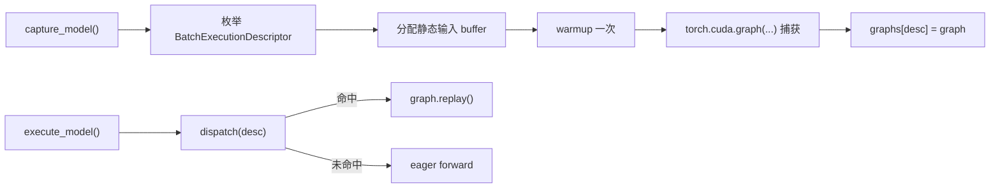

# 课时09 vLLM 高级特性：CUDA Graph 详解

> 版本锚点：`main@8c17e46`。代码块标题是片段起点，省略处用 `...` 标注。

## 0. 本节要解决什么

1. CUDA Graph 在 decode 阶段省掉了什么；
2. 为什么它要求静态地址、静态形状；
3. vLLM 的五种 `CUDAGraphMode` 分别适合什么场景；
4. 怎么确认一张图真的被捕获和重放。

**一句话结论**：CUDA Graph 把“一串 kernel launch”录成一张图，重放时只提交一次；vLLM 用 padding + 预分配 buffer + 分段捕获，把动态 batch 塞进静态图。

## 1. 为什么 decode 需要 CUDA Graph

decode 每步只生成 1 个 token，但一个 Transformer 层有几十个 kernel。GPU 算得很快，CPU 提交 kernel 却很慢：

```text
CPU: launch QKV -> launch attention -> launch MLP -> launch ...
GPU:    [kernel]        [kernel]            [kernel]
```

当 batch 很小、序列很短时，GPU 经常在等 CPU 提交下一个 kernel。CUDA Graph 的做法是：

1. 先在一个专用 stream 上把所有 kernel 跑一遍并“录制”；
2. 之后用 `graph.replay()` 一次性提交整张图；
3. CPU 只发一次命令，GPU 连续执行。

代价是图里的指针和形状必须固定。

## 2. 四个硬约束

| 约束 | 原因 | vLLM 的应对 |
|---|---|---|
| 张量地址固定 | 图记录的是指针 | 预分配 `InputBuffers`，每步只改内容 |
| 形状固定 | kernel 的 grid/block 参数被录死 | padding 到捕获过的尺寸 |
| 不能有 CPU 同步 | `.item()` / `.cpu()` 会打断图 | 把需要 host 的值提前算好或异步拷贝 |
| 不能有动态控制流 | Python `if` 不会重放 | 按 batch 描述符分桶，每种形状一张图 |

所以“能不能用 CUDA Graph”本质上取决于：这一步的输入形状是否落在已捕获的桶里，以及所有输入是否写进了固定 buffer。

## 3. 五种模式

`CUDAGraphMode`（`vllm/config/compilation.py:165`）：

| 模式 | 含义 | 适用 |
|---|---|---|
| `NONE` | 不捕获 | 调试、动态形状太多 |
| `PIECEWISE` | 只捕获 attention / MLP 等片段，片段之间 eager | 有动态 op（如自定义 kernel） |
| `FULL` | 整个 forward 一张图 | decode 稳定、形状可枚举 |
| `FULL_DECODE_ONLY` | decode 用 FULL，mixed batch 用 NONE | 常见默认组合 |
| `FULL_AND_PIECEWISE` | decode 用 FULL，mixed 用 PIECEWISE | 兼顾覆盖率和灵活性 |

优化等级 `-O0` ~ `-O3` 会给出一组默认值（`docs/design/optimization_levels.md`）：

- `-O0`：`cudagraph_mode=NONE`；
- `-O1`：`PIECEWISE`；
- `-O2`（默认）：`FULL_AND_PIECEWISE`；
- `-O3`：当前与 `-O2` 相同。

## 4. 捕获流程

`GPUModelRunner.capture_model`（`model_runner.py:1172`）在 `compile_or_warm_up_model` 阶段被调用：

```python title="vllm/v1/worker/gpu/model_runner.py:1172"
def capture_model(self, *, profile_only: bool = False) -> int:
    assert self.cudagraph_manager is not None
    capture_encoder = (
        self.model_state.supports_mm_inputs
        and self.model_state.encoder_runner.has_cudagraph()
    )
    capture_decoder = self.cudagraph_manager.needs_capture()
    if not capture_encoder and not capture_decoder:
        logger.warning(
            "Skipping encoder and decoder CUDA graph capture. ..."
        )
```

真正的捕获在 `CudaGraphManager.capture`（`cudagraph_utils.py:459`）。它按 `BatchExecutionDescriptor` 枚举：

- decode 的 query length（通常是 1）；
- request 数量（如 1, 2, 4, 8, ..., max_num_reqs）；
- 是否有 LoRA、是否 ubatch。

每种组合捕获一张图，存在 `self.graphs` 里。运行时 `dispatch` 用当前 batch 的描述符查表；查不到就退回 eager 或 padding 到最近的桶。



## 5. PIECEWISE 与 breakable graph

FULL 图要求整个 forward 都能被录。遇到以下情况会退化成 PIECEWISE：

- 自定义 op 内部有 CPU 同步；
- attention metadata 需要每步重新计算（例如 varlen decode）；
- 多模态 encoder 的动态形状。

PIECEWISE 的做法是：只在 attention、MLP 等“形状稳定”的片段上捕获，片段之间回到 eager。vLLM 还有 `breakable_cudagraph.py`，允许在 CUDA Graph 中间“打断”去执行 eager 代码，再继续重放。

## 6. 源码走读：CUDAGraphWrapper

`vllm/compilation/cuda_graph.py:144` 的 `CUDAGraphWrapper` 是“可调用对象 → 图”的包装器：

```python title="vllm/compilation/cuda_graph.py:144"
class CUDAGraphWrapper:
    def __init__(self, ...):
        ...
    def __call__(self, *args, **kwargs):
        ...
```

它负责：

1. 第一次调用时捕获；
2. 后续调用直接 `replay`；
3. 如果输入形状不在已捕获集合里，走 fallback；
4. 处理 CUDA Graph 的 memory pool（图内分配的张量不能跨图复用）。

## 7. 最小实验：eager vs graph

两种模式要**分开进程跑**：同一个进程里先后建两个 `LLM`，PyTorch 的显存缓存不一定还给驱动，第二个实例可能缩 KV 甚至 OOM。

保存为 `bench_cudagraph.py`：

```python
import argparse
import time

from vllm import LLM, SamplingParams

parser = argparse.ArgumentParser()
parser.add_argument("--eager", action="store_true", help="disable CUDA Graph")
args = parser.parse_args()

llm = LLM(
    model="facebook/opt-125m",
    max_model_len=256,
    enforce_eager=args.eager,
    gpu_memory_utilization=0.35,
)
params = SamplingParams(max_tokens=32, temperature=0, ignore_eos=True)
prompt = "Hello"

llm.generate([prompt], params)  # warmup / capture

start = time.perf_counter()
for _ in range(5):
    llm.generate([prompt], params)
elapsed = (time.perf_counter() - start) / 5

print(f"enforce_eager={args.eager}: {elapsed * 1000:.2f} ms/request")
```

运行两次：

```bash
.venv/bin/python bench_cudagraph.py --eager
.venv/bin/python bench_cudagraph.py
```

在 125M 小模型上，graph 通常能把 decode 的端到端延迟降低 10%–30%（具体取决于 CPU 和 GPU）。如果 graph 反而更慢，检查：

- 是否每次请求都触发未命中的形状，导致反复 fallback；
- 是否 `max_num_seqs` 很大，捕获了太多桶，启动时间变长；
- 是否 batch 里混入 prefill，导致走了 mixed 模式；
- 确认 eager 那次带了 `--eager`、graph 那次没带，别把两次参数搞反。

## 8. 常见误区

1. **以为 CUDA Graph 能加速 prefill**。prefill 形状变化大，通常只对 decode 有意义。
2. **以为开了 graph 就一定更快**。小 batch + 大模型时，GPU 计算占主导，收益有限；捕获和显存开销反而增加。
3. **以为 capture 一次就永久有效**。权重更新、KV cache 重新分配、模型结构变化后都要重新捕获。
4. **在图里调用 `.item()`**。这会强制同步，轻则 fallback，重则捕获失败。
5. **忽略 padding 成本**。为了命中桶而 pad 太多，省下的 launch 开销会被无效计算吃掉。

## 9. 自检 5 问

1. CUDA Graph 主要省的是 GPU 计算还是 CPU launch？
2. 为什么 vLLM 要预分配 `InputBuffers`？
3. `PIECEWISE` 和 `FULL` 的区别是什么？
4. 什么情况下会 fallback 到 eager？
5. 为什么 `-O0` 启动最快但吞吐最低？

参考答案：

1. CPU launch（以及一部分 Python 开销），GPU 计算不变。
2. 图记录固定地址，每步只能改内容不能换指针。
3. PIECEWISE 只捕获形状稳定的片段；FULL 捕获整个 forward。
4. 当前 batch 的描述符没有对应图，或输入形状超出捕获范围。
5. 不编译、不捕获、不做 autotune，启动快但每步都有完整 launch 开销。

## 10. 延伸阅读

- `docs/design/cuda_graphs.md`；
- `docs/design/cuda_graphs_multimodal.md`；
- `vllm/compilation/breakable_cudagraph.py`；
- 下一课：课时10 进入 torch.compile，看编译和 CUDA Graph 如何配合。
