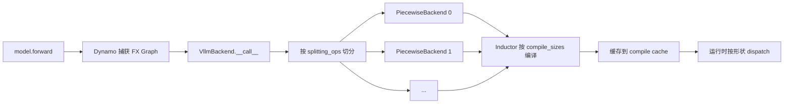

# 课时10 vLLM 高级特性：torch.compile 与编译栈

> 版本锚点：`main@8c17e46`。代码块标题是片段起点，省略处用 `...` 标注。

## 0. 本节要解决什么

1. `torch.compile` 在 vLLM 里到底编译了什么；
2. vLLM 为什么要自定义 Inductor backend；
3. 分段编译（piecewise compilation）怎么切、怎么缓存；
4. `-O0` ~ `-O3` 分别改了什么。

**一句话结论**：Dynamo 把模型捕获成 FX Graph，vLLM 的 `VllmBackend` 在 attention 等位置把图切成多段，每段交给 Inductor 按形状编译并缓存；运行时分段调用编译产物，段与段之间还能插入 CUDA Graph 或 eager 代码。

## 1. torch.compile 的三个阶段

| 阶段 | 角色 | 产物 |
|---|---|---|
| 捕获 | TorchDynamo | FX Graph + guards |
| 变换 | AOTAutograd / Inductor passes | 去 functionalize、融合后的图 |
| 代码生成 | Inductor | Triton / C++ kernel，缓存到磁盘 |

guards 是“这张图适用的条件”（dtype、shape、requires_grad 等）。条件不满足就重新捕获，也就是常说的 recompile。vLLM 通过限制动态维度和枚举 `compile_sizes`，把 guard 数量控制在可接受范围。

## 2. 为什么 vLLM 需要自定义 backend

标准 `torch.compile` 会把整个 forward 编成一张图，但 vLLM 有三个特殊需求：

1. **attention 必须切开**：attention 的 metadata（block table、seq_lens）每步变化，无法整图静态化；
2. **要插入 CUDA Graph**：分段后可以在段边界捕获/重放；
3. **要复用自定义算子**：RMSNorm、量化、AllReduce 等需要走 vLLM 自己的 op。

所以 vLLM 提供 `CompilationMode.VLLM_COMPILE` 和 `VllmBackend`：

```python title="vllm/compilation/backends.py:832"
class VllmBackend:
    """The compilation backend for `torch.compile` with vLLM.
    ...
    The major work of this backend is to split the graph into
    piecewise graphs, and pass them to the piecewise backend.
    ...
    """
```

## 3. 四种编译模式

`CompilationMode`（`vllm/config/compilation.py:38`）：

| 模式 | 行为 | 适用 |
|---|---|---|
| `NONE` | 完全 eager | 调试、启动最快 |
| `STOCK_TORCH_COMPILE` | 标准 `torch.compile` | 对比基线 |
| `DYNAMO_TRACE_ONCE` | 只 trace 一次，避免反复捕获 | 动态形状多、编译时间敏感 |
| `VLLM_COMPILE` | 自定义 backend + 分段 + 缓存 | 默认生产路径 |

## 4. 分段编译流程



切分点由 `CompilationConfig.splitting_ops` 决定（`compilation.py:619`），默认包含 attention 相关的 op。切完之后：

- 每个 `PiecewiseBackend`（`piecewise_backend.py:86`）负责一段；
- 每段按 `compile_sizes` 编译多个形状；
- 运行时按实际 shape 选择最接近的编译产物；
- 段与段之间可以走 CUDA Graph（`PIECEWISE` 模式）。

`PiecewiseBackend` 的 docstring 说得很直接：

```python title="vllm/compilation/piecewise_backend.py:99"
"""The backend for piecewise compilation.
It mainly handles the compilation of static shapes and
dispatching based on runtime shape.

We will compile `self.graph` once for the general shape,
and then compile for different shapes specified in
`compilation_config.compile_sizes`.
"""
```

## 5. 编译 pass

vLLM 在 Inductor 的 post-grad 阶段插入 `PostGradPassManager`（`compilation/passes/pass_manager.py:96`），常见融合：

| pass | 融合内容 |
|---|---|
| `fuse_norm_quant` | RMSNorm + 量化 |
| `fuse_act_quant` | SiLU/Mul + 量化 |
| `fuse_attn_quant` | Attention/MLA + 量化 |
| `fuse_allreduce_rms` | AllReduce + RMSNorm |
| `enable_qk_norm_rope_fusion` | QK Norm + RoPE |
| `fuse_rope_kvcache` | RoPE + KV cache 写入 |

这些 pass 由 `CompilationConfig.pass_config` 控制，`-O0` 全部关闭，`-O2` 默认开启常用项。融合的价值是减少 kernel 数量和中间张量读写，尤其是量化模型。

## 6. 优化等级到底改了什么

`docs/design/optimization_levels.md` 给了完整映射，核心差异：

| 等级 | 编译 | CUDA Graph | 融合 | FlashInfer autotune |
|---|---|---|---|---|
| `-O0` | `NONE` | `NONE` | 全关 | 关 |
| `-O1` | `VLLM_COMPILE` | `PIECEWISE` | 基础 | 开 |
| `-O2` | `VLLM_COMPILE` | `FULL_AND_PIECEWISE` | 全部默认 | 开 |
| `-O3` | 当前同 `-O2` | 同 `-O2` | 同 `-O2` | 开 |

用户显式设置的 flag 优先级高于优化等级。例如 `-O2 --compilation-config.cudagraph-mode NONE` 会保留编译但关掉 CUDA Graph。

## 7. 编译缓存

vLLM 会把编译产物缓存到本地（默认在 `~/.cache/vllm/torch_compile_cache`），key 通常包含：

- 模型结构 / 代码 hash；
- `CompilationConfig` 的 hash；
- 平台 / torch 版本；
- 形状集合。

命中缓存时启动会快很多；代码或配置一改，key 变化，自动重新编译。`VLLM_COMPILE_CACHE_SAVE_FORMAT` 可以控制缓存格式（`binary` / `unpacked`）。

## 8. 最小实验：对比启动时间

```python
import time

from vllm import LLM


def measure(level: int) -> tuple[float, float]:
    start = time.perf_counter()
    llm = LLM(
        model="facebook/opt-125m",
        max_model_len=256,
        optimization_level=level,
        gpu_memory_utilization=0.35,
    )
    startup = time.perf_counter() - start
    compile_time = llm.llm_engine.vllm_config.compilation_config.compilation_time
    return startup, compile_time


for level in (0, 2):
    startup, compile_time = measure(level)
    print(f"-O{level}: startup={startup:.2f}s compile={compile_time:.2f}s")
```

预期：`-O0` 启动最快、`compile_time` 为 0；`-O2` 首次启动多花几秒到几十秒，第二次因为缓存会明显变快。用 `vllm bench throughput` 对比两者吞吐，能看到编译 + CUDA Graph 的收益。

## 9. 常见误区

1. **以为 `-O2` 一定比 `-O1` 快**。小模型 / 短序列时，编译和捕获开销可能超过收益。
2. **以为编译一次永久有效**。权重、代码、配置、torch 版本变化都会让缓存失效。
3. **以为 attention 也被整图编译**。attention 默认是切分点，segment 之间是边界。
4. **以为 dynamic shape 越多越好**。动态维度会增加 guard 和重编译；vLLM 更倾向枚举 `compile_sizes`。
5. **忽略 `custom_ops`**。把 op 标成 custom 可以避免 Inductor 生成错误代码，但也可能失去融合机会。

## 10. 自检 5 问

1. Dynamo、Inductor、vLLM backend 各自负责什么？
2. 为什么 attention 通常是切分点？
3. `PiecewiseBackend` 如何应对不同 batch 形状？
4. `-O0` 和 `-O2` 的启动时间差主要来自哪里？
5. 编译缓存 key 包含哪些信息？

参考答案：

1. Dynamo 捕获图，Inductor 生成 kernel，VllmBackend 负责切分和调度编译。
2. attention 的 metadata 每步变化，无法整图静态化；切开后可以插 CUDA Graph。
3. 按 `compile_sizes` 预编译多个形状，运行时按实际 shape dispatch。
4. 编译、融合 pass、CUDA Graph 捕获、FlashInfer autotune。
5. 模型代码 / 结构、CompilationConfig、平台与 torch 版本、形状集合等。

## 11. 延伸阅读

- `docs/design/torch_compile.md`；
- `docs/design/debug_vllm_compile.md`；
- `docs/design/optimization_levels.md`；
- 下一课：课时11 进入 GPU 算子开发，看 Inductor 之外的手写 kernel。
