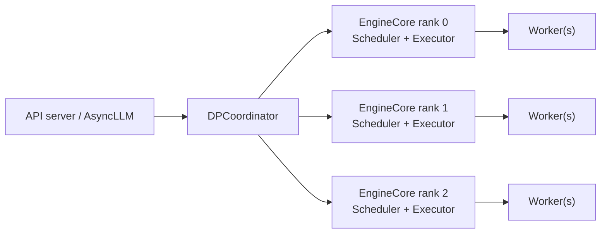

# 课时13 vLLM 分布式推理：数据并行

> 版本锚点：`main@8c17e46`。代码块标题是片段起点，省略处用 `...` 标注。

## 0. 本节要解决什么

1. DP 和 TP 的本质区别；
2. 一个 DP 部署里有哪些进程；
3. DP 的三种负载均衡模式；
4. 请求波次（wave）是怎么同步的。

**一句话结论**：DP 复制整个模型、按请求切分流量；每个 DP rank 有独立的 EngineCore 和 Scheduler，rank 之间只同步“是否还有请求”和少量 padding，不共享 KV。

## 1. DP vs TP

| | DP（数据并行） | TP（张量并行） |
|---|---|---|
| 切分对象 | 请求 | 单层权重 / attention head |
| 模型副本 | 每 rank 一份完整模型 | 每 rank 一份分片 |
| 通信 | 少量 all-reduce（wave 同步） | 每层 all-reduce / all-gather |
| 显存 | 每 rank 都要放下完整模型 | 权重和 KV 分摊到多卡 |
| 适用 | 单卡能放下模型，想提高总吞吐 | 单卡放不下，或要降低单请求延迟 |

DP 不减少单请求延迟，它提高的是**总吞吐**：4 个 DP rank 约等于 4 个独立副本，但共享一个前端和一套调度统计。

## 2. 进程拓扑



- `DPCoordinator`（`vllm/v1/engine/coordinator.py:23`）是独立进程，收集各 rank 的队列长度并广播 wave 状态；
- 每个 rank 是一个 `DPEngineCoreProc`（`core.py:2592`），内部有自己的 Scheduler、KVCacheManager、Executor；
- 前端根据 LB 模式选择 `DPAsyncMPClient` 或 `DPLBAsyncMPClient`。

## 3. 三种负载均衡模式

| 模式 | 谁分发请求 | 配置 | 适用 |
|---|---|---|---|
| 内部 LB | `DPLBAsyncMPClient` 按 rank 统计分发 | 默认 | 单节点 / 小集群 |
| 外部 LB | 外部网关按 rank 分发 | `--data-parallel-external-lb` | K8s 一 pod 一 rank |
| 混合 LB | 节点内 vLLM 分发，节点间外部 LB | `--data-parallel-hybrid-lb` | 多节点宽 EP |

内部 LB 的客户端是 `DPLBAsyncMPClient`（`core_client.py:1780`），它订阅 Coordinator 发布的队列长度，选择等待队列最短的 rank。

## 4. wave：DP 的同步单位

DP rank 之间要同步“现在是不是还有请求”。vLLM 用 `request wave` 表示一轮“所有 rank 从 running 进入 paused”的周期：

```python title="vllm/v1/engine/coordinator.py:23"
class DPCoordinator:
    """Coordinator process used for data-parallel deployments (DP>1).
    ...
    * Keeps track of the current DP "request wave" number and running state
      of the engines. ...
    """
```

每个 rank 在 `_has_global_unfinished_reqs`（`core.py:2868`）里做 all-reduce：

- 如果所有 rank 都没有未完成请求，进入 paused；
- 某个 rank 收到新请求时，通过 Coordinator 广播 `START_DP_WAVE`，所有 rank 一起进入 running。

为什么需要 wave：DP rank 之间的 CUDA Graph 捕获、DP padding、采样步数需要对齐；如果各 rank 独立启停，collective 会错位。

## 5. DP 的 padding 与 CUDA Graph 同步

即使请求只落在 rank 0，其他 rank 也要参与 collective。vLLM 的做法是：

- 空闲 rank 执行 dummy batch；
- `sync_cudagraph_and_dp_padding`（`vllm/v1/worker/gpu/dp_utils.py:49`）把各 rank 的 batch 形状对齐到同一个 CUDA Graph 桶；
- 每 `dp_sync_interval` 步做一次 finish-sync all-reduce。

```python title="vllm/v1/worker/gpu/dp_utils.py:49"
def sync_cudagraph_and_dp_padding(...):
    ...
```

这就是为什么 DP 部署里，即使某个 rank 没有请求，GPU 也不是完全空闲。

## 6. DP + EP

MoE 模型常用“DP + EP”：

```bash
vllm serve <moe-model> \
  --data-parallel-size 2 \
  --enable-expert-parallel \
  --tensor-parallel-size 8
```

含义：

- attention 层按 DP 复制（每个 rank 一份）；
- MoE expert 按 EP 切分到所有 rank；
- token 通过 all-to-all 发送到拥有对应 expert 的 rank。

这就是课时15/16 的内容。DP 负责“请求并行”，EP 负责“专家并行”。

## 7. 最小实验：起一个 DP=2 的服务

```bash
vllm serve facebook/opt-125m \
  --data-parallel-size 2 \
  --max-model-len 512 \
  --enforce-eager
```

观察：

1. 启动日志里应该出现两个 `EngineCore_DP0` / `EngineCore_DP1`；
2. `nvidia-smi` 看到两张卡各有一份模型；
3. `/metrics` 里会有按 DP rank 区分的队列指标；
4. 用 `vllm bench serve --num-prompts 200` 压测，总吞吐应接近单卡的两倍（如果单卡没打满）。

如果第二张卡一直空闲，检查：

- 是否用了外部 LB 但只配了一个地址；
- 是否请求都落在同一个 rank（内部 LB 的统计没更新）。

## 8. 常见误区

1. **以为 DP 能降低单请求延迟**。它只提高总吞吐，单请求仍在一个 rank 上跑。
2. **以为 DP 会分摊权重显存**。每个 rank 都加载完整模型（除非同时用 TP/EP）。
3. **以为 rank 之间共享 prefix cache**。默认不共享；每个 rank 有自己的 KV cache。
4. **忽略 wave 同步**。空闲 rank 也要参与 collective，不能直接退出。
5. **在非 MoE 模型上用外部 LB**。当前外部 LB 主要面向 MoE/宽 EP 部署。

## 9. 自检 5 问

1. DP 和 TP 的切分对象分别是什么？
2. `DPCoordinator` 负责哪三件事？
3. 内部 LB 和外部 LB 的区别是什么？
4. 为什么 DP rank 之间需要 wave 同步？
5. DP + EP 时，attention 和 MoE 分别怎么切？

参考答案：

1. DP 切请求，TP 切权重/头。
2. 收集队列统计、维护 wave/running 状态、广播 `START_DP_WAVE`。
3. 内部 LB 由 vLLM 客户端按统计分发；外部 LB 由网关分发，vLLM 不管。
4. 对齐 CUDA Graph、padding 和 collective，避免 rank 之间步调不一致。
5. attention 按 DP 复制，expert 按 EP 切分到所有 rank。

## 10. 延伸阅读

- `docs/design/arch_overview.md` 的 DP 章节；
- `vllm/v1/engine/coordinator.py`；
- `vllm/v1/worker/gpu/dp_utils.py`；
- 下一课：课时14 进入 TP 和 PP。
