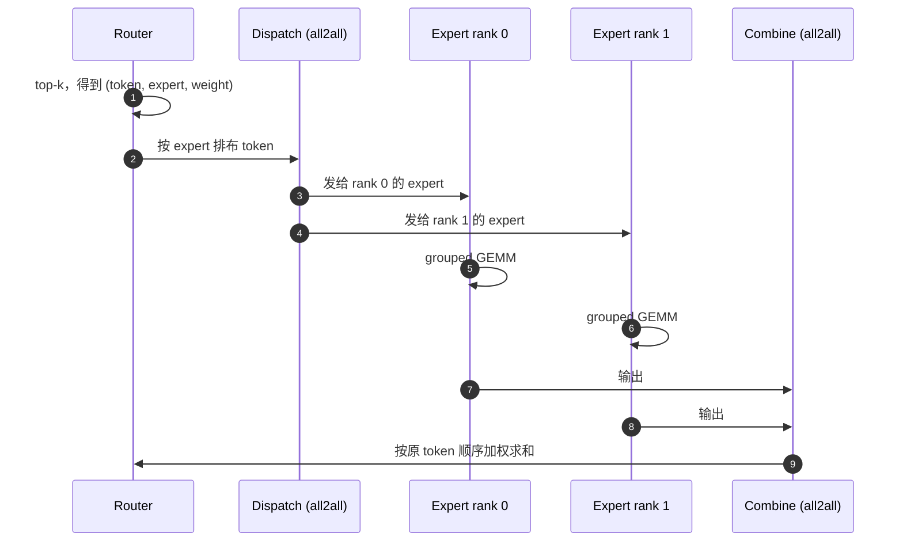

# 课时15 vLLM 分布式推理：专家并行

> 版本锚点：`main@8c17e46`。代码块标题是片段起点，省略处用 `...` 标注。

## 0. 本节要解决什么

1. MoE 的 router / expert / shared expert 分别是什么；
2. EP 和 TP 在 MoE 层上的区别；
3. Dispatch-Compute-Combine 三段式怎么跑；
4. vLLM 的 all2all 后端怎么选。

**一句话结论**：EP 把“专家”分到不同 rank，token 先 dispatch 到拥有目标专家的 rank，算完再 combine 回来；vLLM 把这段通信抽象成 `All2AllManager`，上层 `FusedMoE` 不关心底层用 DeepEP、NIXL 还是 FlashInfer。

## 1. MoE 基础

一个 MoE 层包含：

- **router**：`logits = x @ W_router`，取 top-k；
- **experts**：每个 expert 是一个小 MLP；
- **shared expert**：所有 token 都走的公共 MLP（DeepSeek 等模型有）；
- **combine**：按 router 权重把各 expert 的输出加权求和。

```text
x -> router -> top-k indices + weights
  -> for each selected expert: expert_i(x)
  -> sum(weight_i * out_i)
```

MoE 的难点是**负载不均衡**：热门 expert 会被很多 token 选中，冷门 expert 闲着。EP + EPLB 就是为解决这个问题。

## 2. EP vs TP

| | TP 下的 MoE | EP 下的 MoE |
|---|---|---|
| 每个 expert 的权重 | 切到所有 rank | 完整放在某个 rank |
| 每 rank 持有的 expert | 所有 expert 的一部分 | 一部分 expert |
| 通信 | 每个 expert 的 all-reduce | token 的 all-to-all |
| 适合 | 小规模、单节点 | 大规模、跨节点 |

EP 的关键变化：token 不再“每个 rank 都算所有 expert”，而是“发到 expert 所在的 rank”。

## 3. Dispatch-Compute-Combine



三个阶段的工程难点：

1. **dispatch 的排列**：token 要按目标 rank 分组，还要记录“原来属于哪个 token”；
2. **grouped GEMM**：不同 expert 的 token 数不同，kernel 要支持变长分组；
3. **combine 的还原**：把结果按原顺序写回，并乘 router weight。

## 4. vLLM 的实现分层

| 层 | 作用 | 源码 |
|---|---|---|
| `FusedMoEFactory` | 根据配置创建 MoE 层 | `fused_moe/layer.py:95` |
| `MoERunner` | 组织 router / experts / combine | `fused_moe/runner/moe_runner.py:240` |
| `FusedMoEModularMethod` | 可组合的 MoE 方法 | `fused_moe_modular_method.py:33` |
| `ExpertMapManager` | 全局 expert id ↔ 本地 expert id | `expert_map_manager.py:152` |
| `All2AllManagerBase` | dispatch/combine 的通信抽象 | `base_device_communicator.py:34` |

`FusedMoEFactory` 的参数很多，核心是：

```python title="vllm/model_executor/layers/fused_moe/layer.py:95"
def FusedMoEFactory(
    num_experts: int,
    top_k: int,
    hidden_size: int,
    intermediate_size: int,
    ...
    enable_eplb: bool = False,
    num_redundant_experts: int = 0,
    n_shared_experts: int | None = None,
    ...
):
```

## 5. all2all 后端

`All2AllBackend`（`vllm/config/parallel.py:53`）可选：

| 后端 | 实现 | 特点 |
|---|---|---|
| `allgather_reducescatter` | `AgRsAll2AllManager` | 通用，通信量较大 |
| `deepep_high_throughput` | `DeepEPHTAll2AllManager` | 高吞吐，适合 prefill |
| `deepep_low_latency` | `DeepEPLLAll2AllManager` | 低延迟，适合 decode |
| `nixl_ep` | `NixlEPAll2AllManager` | 基于 NIXL |
| `flashinfer_nvlink_*` | FlashInfer NVLink | 单节点 NVLink |
| `mori` / `moonep` | MoRI / MoonEP | 特定硬件/拓扑 |
| `passthrough` | `PassThroughAll2AllManager` | MoE 后端自己做 dispatch |

默认是 `auto`，按硬件、DP/EP 规模和 dtype 选。选错后端不会“算错”，但可能性能很差，或者启动时直接报不兼容。

## 6. 源码走读：ExP 的通信抽象

`All2AllManagerBase`（`base_device_communicator.py:34`）定义：

```python title="vllm/distributed/device_communicators/base_device_communicator.py:34"
class All2AllManagerBase:
    ...
```

子类只需要实现 `dispatch` / `combine`（或等价的 prepare/finalize），上层 `FusedMoE` 通过 `all2all_utils` 拿到 manager。

`ExpertMapManager` 负责把“全局 expert id”映射到“本 rank 实际持有的 expert”。EP 下不是每个 rank 都有所有 expert，所以 router 输出的 global id 要先查表，才能找到本地权重。

## 7. 最小实验：Granite MoE + EP

```bash
vllm serve ibm-granite/granite-3.0-1b-a400m \
  --tensor-parallel-size 2 \
  --enable-expert-parallel \
  --max-model-len 2048
```

观察：

- 启动日志会打印 expert 分布和 all2all backend；
- 每个 rank 只持有部分 expert；
- `vllm bench serve` 的吞吐应高于纯 TP（如果通信不是瓶颈）。

可以对比：

```bash
# 纯 TP
vllm serve ibm-granite/granite-3.0-1b-a400m --tensor-parallel-size 2
```

如果 EP 启动失败，先看 `all2all_backend` 是否与硬件/模型兼容，再退回 `allgather_reducescatter` 验证正确性。

## 8. 常见误区

1. **以为 EP 能用于所有模型**。只有 MoE 层有 expert；dense 模型没有可并行的 expert。
2. **以为 EP 一定比 TP 快**。小规模、单节点时，all2all 可能比 all-reduce 更贵。
3. **忽略 expert 分布**。热门 expert 集中在一个 rank 会造成长尾。
4. **以为 shared expert 也走 EP**。shared expert 通常是每个 rank 都有的 dense MLP。
5. **不看 all2all 后端**。DeepEP HT 和 LL 的适用阶段不同，选错会拖慢一半。

## 9. 自检 5 问

1. EP 和 TP 在 MoE 层上的切分对象有什么不同？
2. Dispatch-Compute-Combine 三个阶段各自做什么？
3. `ExpertMapManager` 解决什么问题？
4. `passthrough` 后端是什么意思？
5. EP 下为什么需要 EPLB？

参考答案：

1. TP 切每个 expert 的权重；EP 把不同 expert 分到不同 rank。
2. dispatch 按 expert 重排 token；compute 做 grouped GEMM；combine 按原顺序加权求和。
3. 全局 expert id 与本地 expert 权重的映射。
4. MoE 后端自己完成 dispatch/combine，不再走独立 all2all。
5. expert 热度不均会导致 rank 间负载失衡，EPLB 通过复制/迁移 expert 缓解。

## 10. 延伸阅读

- `docs/design/fused_moe_modular_kernel.md`；
- `docs/design/moe_kernel_features.md`；
- `vllm/distributed/device_communicators/all2all.py`；
- 下一课：课时16 进入 EPLB。
