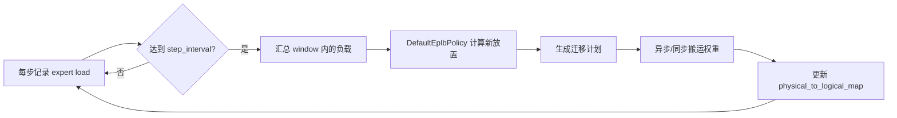

# 课时16 vLLM 分布式推理：EPLB 与弹性专家并行

> 版本锚点：`main@8c17e46`。代码块标题是片段起点，省略处用 `...` 标注。

## 0. 本节要解决什么

1. 为什么 EP 需要负载均衡；
2. 冗余专家（redundant expert）怎么工作；
3. 一次 rebalance 的完整流程；
4. 弹性 EP（elastic EP）和 EPLB 的关系。

**一句话结论**：EPLB 周期性统计每个 expert 的负载，把热门 expert 复制到空闲 rank，并迁移权重、更新 expert map；目标是在 EP 的静态专家分布上，动态逼近“每个 rank 工作量相近”。

## 1. EP 的负载问题

EP 把 expert 固定分到各 rank。如果 router 持续偏向某几个 expert：

- 持有热门 expert 的 rank 成为长尾；
- 其他 rank 算完就等；
- all2all 的 combine 阶段被最慢的 rank 拖住。

MoE 训练里常用 auxiliary loss 鼓励均衡，但推理时模型已经固定，只能靠**运行时重排**：把热门 expert 复制一份到空闲 rank，让 token 分散过去。

## 2. 三个概念

| 概念 | 含义 |
|---|---|
| 逻辑 expert | 模型里的 expert id（0..N-1） |
| 物理 expert | 某个 rank 上实际存放的专家副本 |
| 冗余 expert | 额外复制的物理 expert，用来分担热门逻辑 expert |

例如 8 个逻辑 expert、2 个 rank、2 个冗余：

```text
rank 0: [e0, e1, e2, e3, e0']   # e0' 是 e0 的副本
rank 1: [e4, e5, e6, e7, e1']
```

router 仍然输出逻辑 id；`ExpertMapManager` 把逻辑 id 映射到多个物理副本，再按负载选一个。

## 3. 一次 rebalance 的流程



关键参数（`EPLBConfig`，`vllm/config/parallel.py:171`）：

| 参数 | 默认 | 作用 |
|---|---|---|
| `window_size` | 1000 | 负载统计窗口 |
| `step_interval` | 3000 | 多少步重排一次 |
| `num_redundant_experts` | 自动 | 冗余专家数量 |
| `use_async` | True | 是否异步迁移 |
| `log_balancedness` | False | 打印均衡度 |
| `communicator` | auto | 权重迁移后端（nixl / pynccl / gloo 等） |

## 4. vLLM 的实现结构

| 结构 | 作用 | 源码 |
|---|---|---|
| `EplbState` | 全局状态：窗口、重排、迁移 | `eplb_state.py:321` |
| `EplbModelState` | 单个模型的 expert load / 映射 | `eplb_state.py:77` |
| `EplbLayerState` | 单层 expert 状态 | `eplb_state.py:1349` |
| `DefaultEplbPolicy` | 默认放置策略 | `policy/default.py:20` |
| `rebalance_execute` | 迁移的执行逻辑 | `rebalance_execute.py` |
| `async_worker` | 异步迁移线程 | `async_worker.py` |

`EplbState.rearrange`（`eplb_state.py:930`）是入口：

```python title="vllm/distributed/eplb/eplb_state.py:930"
def rearrange(
    self,
    is_profile: bool = False,
    rank_mapping: dict[int, int] | None = None,
    use_last_expert_load: bool = False,
) -> torch.Tensor | None:
    """Rearrange the experts according to the current load."""
    ...
```

它先把物理 expert 的负载映射回逻辑 expert，再调用 policy 算新放置。

## 5. 异步迁移

`use_async=True` 时，rebalance 不阻塞推理：

1. 主线程继续跑 forward；
2. 后台线程按迁移计划搬运 expert 权重；
3. 搬完后原子更新 `physical_to_logical_map`；
4. 下一次 forward 用新映射。

迁移后端由 `EPLBConfig.communicator` 选择：

- `torch_nccl`：设备侧 P2P；
- `nixl`：跨节点；
- `pynccl`、`symm_mem`：特定拓扑；
- `torch_gloo`：CPU 暂存，最慢但兼容。

迁移期间会短暂占用额外显存（双缓冲），所以 `num_redundant_experts` 不能无限加。

## 6. 弹性 EP

弹性 EP（elastic EP）允许在运行时**扩缩容 EP rank**：

- scale up：新 rank 加入，加载 expert 分片，参与 all2all；
- scale down：某个 rank 退出，先把它的 expert 迁走，再断开。

它和 EPLB 的区别：

| | EPLB | 弹性 EP |
|---|---|---|
| 改变什么 | expert 在 rank 间的分布 | rank 的数量 |
| 触发 | 周期性 / 负载变化 | 运维操作 / 自动扩缩 |
| 依赖 | EP | EP + EPLB |

`vllm/distributed/elastic_ep/` 里的 `ElasticEPScalingExecutor`、`ElasticEPScalingState` 负责状态机；服务层通过 `entrypoints/serve/elastic_ep` 暴露接口。

## 7. 最小实验：打开 EPLB

```bash
vllm serve ibm-granite/granite-3.0-1b-a400m \
  --tensor-parallel-size 2 \
  --enable-expert-parallel \
  --enable-eplb \
  --eplb-config.log-balancedness true \
  --max-model-len 2048
```

观察日志：

- 初始 expert 分布；
- 每 `step_interval` 步的 `Rearranging experts...`；
- 均衡度（balancedness）是否上升。

如果日志里看不到 rebalance，检查：

- 是否真的是 MoE 模型；
- `num_redundant_experts` 是否被算成 0（专家数已经能被 EP 整除且没有冗余）；
- `step_interval` 是否大于压测步数。

## 8. 常见误区

1. **以为 EPLB 能提升单请求延迟**。它优化的是 rank 间负载，单请求仍走原来的 expert。
2. **以为冗余专家越多越好**。每个副本都占显存，且增加迁移成本。
3. **以为 rebalance 无开销**。迁移会占用带宽，异步模式也会短暂双缓冲。
4. **以为 EPLB 等于弹性 EP**。前者调分布，后者调 rank 数。
5. **忽略统计窗口**。窗口太短会抖动，太长会跟不上流量变化。

## 9. 自检 5 问

1. 逻辑 expert 和物理 expert 的区别是什么？
2. 冗余专家如何分担热门 expert 的负载？
3. 一次 rebalance 需要哪些步骤？
4. 异步迁移如何避免阻塞 forward？
5. EPLB 和弹性 EP 的区别是什么？

参考答案：

1. 逻辑是模型定义的 id；物理是某个 rank 上的实际副本。
2. 同一逻辑 id 映射到多个物理副本，router 按负载选择副本。
3. 统计负载 → 计算新放置 → 生成迁移计划 → 搬运权重 → 更新映射。
4. 后台线程搬运，搬完后原子切换映射，forward 继续用旧映射。
5. EPLB 改 expert 分布，弹性 EP 改 rank 数量。

## 10. 延伸阅读

- `vllm/distributed/eplb/`；
- `vllm/distributed/elastic_ep/`；
- `docs/design/expert_substitution.md`；
- 下一课：课时17 进入投机解码。
