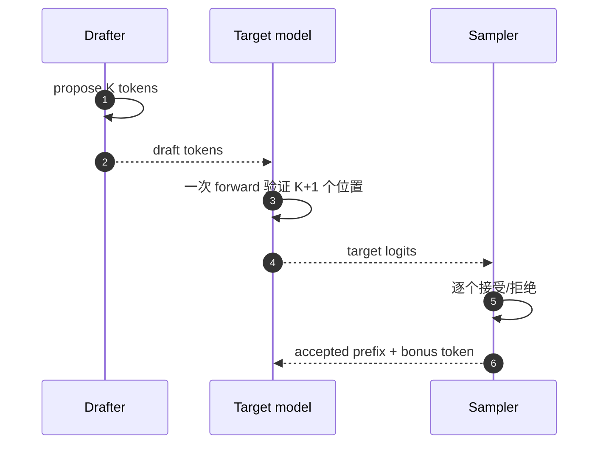

# 课时17 vLLM 高级特性：投机解码

> 版本锚点：`main@8c17e46`。代码块标题是片段起点，省略处用 `...` 标注。

## 0. 本节要解决什么

1. 投机解码为什么能加速 decode；
2. draft / verify / accept 三阶段怎么配合；
3. EAGLE、MTP、ngram、dflash 等方法有什么区别；
4. vLLM 里的 speculator、rejection sampler、adaptive verification 各自负责什么。

**一句话结论**：投机解码用便宜的 draft 先猜 K 个 token，再用一次 target forward 并行验证；被接受的前缀直接产出，被拒绝的位置回滚。收益取决于“接受率 × 草稿长度 > 草稿成本”。

## 1. decode 的瓶颈

自回归 decode 每步只生成一个 token，但要读一遍全部权重和 KV：

```text
for t in range(max_tokens):
    logits = model(x_t, kv_cache)   # 读全部权重 + KV
    x_{t+1} = sample(logits)
```

GPU 算力大量闲置。投机解码的思路：如果有一个便宜的办法先猜出 `[x_{t+1}, ..., x_{t+K}]`，就可以用一次 target forward 同时验证这 K 个位置。

## 2. 三阶段框架



关键点：

- target forward 的输入是 `[last_token, d1, ..., dK]`，一次算出所有位置的 logits；
- 接受规则要保证**输出分布和 target 模型一致**（rejection sampling）；
- 全部接受时，还能额外采一个 bonus token，所以一步最多产出 K+1 个 token。

## 3. 常见方法

`SpeculativeMethod`（`vllm/config/speculative.py:112`）支持：

| 方法 | draft 来源 | 特点 |
|---|---|---|
| `draft_model` | 独立小模型 | 通用，需额外显存 |
| `eagle` / `eagle3` | EAGLE head | 用 target 的 hidden states，接受率高 |
| `mtp` | 模型自带 MTP 头 | DeepSeek 等模型内置 |
| `ngram` / `ngram_gpu` | prompt / 历史 token 匹配 | 无需草稿模型，适合重复文本 |
| `suffix` | 后缀匹配 | 代码补全、重复模式 |
| `dflash` / `dspark` | 模型特定 draft | 与 target 结构耦合 |
| `dfly` | DFly | 特定模型 |

选择建议：

- 有 EAGLE/MTP 权重：优先用模型自带；
- 没有 draft 模型、文本重复度高：`ngram`；
- 通用场景：`draft_model`，但要算显存和带宽账。

## 4. 拒绝采样

设 draft 分布为 `q`，target 分布为 `p`。标准拒绝采样：

```text
接受概率 = min(1, p(x) / q(x))
拒绝后从归一化的 max(0, p - q) 中重新采样
```

这样最终输出严格服从 `p`。vLLM 支持多种策略（`RejectionSampleMethod`）：

- `standard`：标准拒绝采样；
- `synthetic`：合成接受；
- `block`：按块验证；
- `fly`：DFly 专用。

## 5. vLLM 的实现

### 5.1 Speculator

`BaseSpeculator`（`vllm/v1/worker/gpu/spec_decode/speculator.py:74`）定义接口：

```python title="vllm/v1/worker/gpu/spec_decode/speculator.py:74"
class BaseSpeculator(ABC):
    ...
```

`DraftModelSpeculator`（`:165`）是“独立草稿模型”的实现；EAGLE/MTP 等方法有各自的 speculator。

### 5.2 Scheduler 的 lookahead

调度器在 `SchedulerOutput.scheduled_spec_decode_tokens` 里带上草稿 token，并额外分配 lookahead 槽：

```python
new_blocks = self.kv_cache_manager.allocate_slots(
    request,
    num_new_tokens,
    num_lookahead_tokens=self.num_lookahead_tokens,
)
```

这样 target forward 可以一次性把草稿位置的 KV 也算出来。

### 5.3 采样

`RejectionSampler`（`gpu/spec_decode/rejection_sampler.py:152`）负责逐位比较 draft 和 target 的分布，返回接受/拒绝结果。

### 5.4 自适应验证

`AdaptiveVerificationManager`（`adaptive_verification.py:227`）根据历史接受率动态调整每步验证的草稿数：

- 接受率高：多验证几个；
- 接受率低：少验证，避免浪费。

## 6. 最小实验：ngram 投机解码

`ngram` 不需要草稿模型，适合先验证链路：

```python
from vllm import LLM, SamplingParams

llm = LLM(
    model="facebook/opt-125m",
    max_model_len=256,
    enforce_eager=True,
    gpu_memory_utilization=0.4,
    spec_method="ngram",
    spec_tokens=4,
)

prompt = "The quick brown fox jumps over the lazy dog. " * 4
params = SamplingParams(max_tokens=32, temperature=0, ignore_eos=True)
out = llm.generate([prompt], params)[0]
print(out.outputs[0].text)
# 投机接受率在 EngineCore 的 spec metrics / 日志里，不在 RequestOutput 上。
```

重复文本越多，ngram 命中率越高。把 `spec_tokens` 从 1 调到 8，观察输出速度和接受率；如果速度反而下降，说明草稿成本超过了收益。

## 7. 调优清单

| 参数 | 影响 |
|---|---|
| `num_speculative_tokens` | 草稿长度；太大浪费，太小收益低 |
| `method` | draft 的质量和成本 |
| `draft_model` | 草稿模型大小 / 显存 |
| `rejection_sample_method` | 采样正确性和开销 |
| `enable_adaptive_verification` | 动态调整验证长度 |
| batch size | 大 batch 下草稿成本被摊薄，收益更明显 |

经验：EAGLE/MTP 在 1–4 个草稿 token 时收益最好；ngram 在代码补全/重复文本上收益高，通用聊天上可能为负。

## 8. 常见误区

1. **以为草稿越长越好**。拒绝率会随长度上升，target forward 也变贵。
2. **以为投机解码不改变输出**。标准拒绝采样保证分布一致，但非标准方法可能改变结果。
3. **忽略草稿模型的显存**。draft model 也要占 GPU，可能挤占 KV cache。
4. **在小 batch 上期待大收益**。草稿成本固定，batch 越大越容易被摊薄。
5. **和结构化输出一起乱用**。grammar bitmask 与草稿 token 的交互有额外约束，需要看 `has_structured_output_spec_decode`。

## 9. 自检 5 问

1. 投机解码一步最多能产出几个 token？
2. 标准拒绝采样如何保证输出分布不变？
3. EAGLE 和 draft_model 的区别是什么？
4. 为什么 scheduler 要预留 lookahead 槽？
5. 什么情况下投机解码会变慢？

参考答案：

1. K+1（K 个草稿全接受 + 1 个 bonus token）。
2. 接受概率 `min(1, p/q)`，拒绝后从 `max(0, p-q)` 重采样。
3. EAGLE 用 target hidden states 训练 draft head；draft_model 是独立小模型。
4. 让 target forward 一次算完草稿位置的 KV，避免二次分配。
5. 接受率低、草稿成本高、batch 小、draft 模型太大。

## 10. 延伸阅读

- `docs/features/speculative_decoding/`；
- `vllm/config/speculative.py`；
- `vllm/v1/worker/gpu/spec_decode/`；
- 下一课：课时18 进入 PD 分离与 KV 传输。
