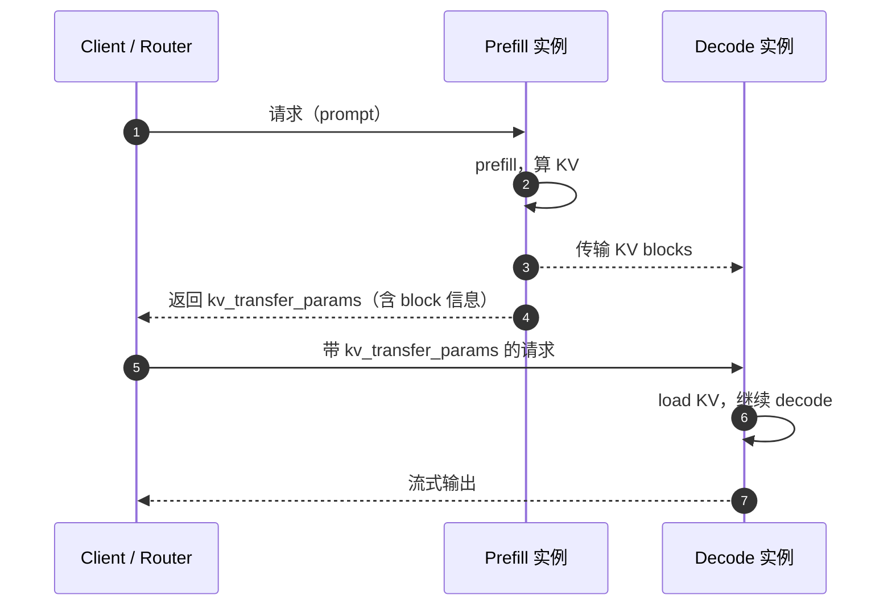

# 课时18 vLLM PD 分离部署与 KV 传输

> 版本锚点：`main@8c17e46`。代码块标题是片段起点，省略处用 `...` 标注。

## 0. 本节要解决什么

1. 为什么要做 PD（Prefill / Decode）分离；
2. KV 如何从 P 实例传到 D 实例；
3. vLLM 的 KV Connector 抽象和常见实现；
4. KV offloading / 分层存储和 HiSparse 是什么。

**一句话结论**：PD 分离把 compute-bound 的 prefill 和 memory-bound 的 decode 放到不同实例；KV 通过 connector 以 block 为单位传输，P 侧负责 save，D 侧负责 load，调度器通过 `kv_transfer_params` 协调。

## 1. 为什么分开

| 阶段 | 瓶颈 | 适合的硬件/并行 |
|---|---|---|
| prefill | 算力、长序列 attention | 高算力 GPU、TP |
| decode | 显存带宽、KV cache 容量 | 大显存、更多并发 |

混部时，长 prompt 的 prefill 会打断 decode 的连续 batch，导致 TPOT 抖动。PD 分离后：

- P 实例专心做 prefill，追求 TTFT；
- D 实例专心做 decode，追求 TPOT 和吞吐；
- 两边可以独立扩缩容。

代价是要传 KV，且需要路由器把请求按阶段分发。

## 2. 端到端流程



关键角色：

- P 侧 connector：`kv_producer`，负责 save；
- D 侧 connector：`kv_consumer`，负责 load；
- 同一个 connector 也可以 `kv_both`（offloading 场景）。

## 3. KVConnector 抽象

`KVTransferConfig`（`vllm/config/kv_transfer.py:85`）：

```python title="vllm/config/kv_transfer.py:85"
class KVTransferConfig:
    kv_connector: str | None = None
    kv_role: KVRole | None = None
    kv_buffer_device: str = ...
    kv_connector_extra_config: dict[str, Any] = field(default_factory=dict)
    kv_connector_module_path: str | None = None
```

`kv_role` 取值：`kv_producer` / `kv_consumer` / `kv_both`。

`KVConnectorBase_V1`（`vllm/distributed/kv_transfer/kv_connector/v1/base.py:182`）把 connector 分成 scheduler 侧和 worker 侧：

| 方法 | 侧 | 作用 |
|---|---|---|
| `get_num_new_matched_tokens` | scheduler | 查询远端有多少 KV 可复用 |
| `build_connector_meta` | scheduler | 生成本步的传输指令 |
| `start_load_kv` | worker | D 侧发起加载 |
| `save_kv_layer` | worker | P 侧保存某一层 KV |
| `wait_for_save` | worker | 等待保存完成 |
| `request_finished` | scheduler | 请求结束，释放远端资源 |

这种“scheduler 决策 + worker 执行”的拆分，让 KV 传输可以异步进行，不阻塞调度。

## 4. 常见 connector

| Connector | 模式 | 特点 |
|---|---|---|
| `NixlConnector` | pull / push | 基于 NIXL，RDMA/IB，支持跨节点 |
| `MooncakeConnector` | pull | Mooncake 传输引擎 |
| `LMCacheConnectorV1` | both | LMCache 缓存层 |
| `SimpleCPUOffloadConnector` | both | KV 卸载到 CPU，单实例 |
| `OffloadingConnector` | both | 通用 offload |
| `MultiConnector` | 组合 | 把多个 connector 串起来 |
| `HiSparseConnector` | both | GPU/CPU 分层 + 稀疏保留 |
| `MoriIOConnector` | pull | MoRI IO |

NIXL 有两种模式：

- `NixlPullConnector`（`nixl/connector.py:374`）：D 主动从 P 读；
- `NixlPushConnector`（`:415`）：P 主动写到 D 的预分配内存。

Push 模式减少 D 侧的等待，但要求 D 提前分配好接收 buffer。

## 5. KV offloading 与分层

PD 之外，另一个方向是**单实例内的 KV 卸载**：

- `vllm/v1/simple_kv_offload/`：把 KV 放到 CPU，GPU 只保留热块；
- `vllm/v1/kv_offload/tiering/`：CPU / 文件系统 / P2P 多级存储；
- `vllm/v1/hisparse/`：分层 + 稀疏保留，适合超长上下文。

分层的基本思想：

```text
GPU HBM (hot) -> CPU DRAM (warm) -> NVMe/远端 (cold)
```

调度器需要知道“哪些块在 GPU、哪些在 CPU”，否则会把请求调度到错误的位置。`KVCacheManager` 的 block 状态和 connector 的 metadata 共同维护这份映射。

## 6. 源码走读：scheduler 侧

`Scheduler.schedule` 在 waiting 段会向 connector 询问远端命中：

```python
ext_tokens, load_kv_async = self.connector.get_num_new_matched_tokens(
    request, num_computed_tokens
)
```

如果命中，`num_computed_tokens` 可以直接跳过这部分；随后 `build_connector_meta` 把“从哪个实例、哪个 block 拉多少”写进 `SchedulerOutput.kv_connector_metadata`。

worker 侧在 `execute_model` 前后调用：

```python
self.kv_connector.pre_forward(scheduler_output, input_batch, attn_metadata=...)
...
self.kv_connector.post_forward(finished_req_ids)
```

具体实现里，`start_load_kv` / `save_kv_layer` / `wait_for_save` 由 connector 决定同步还是异步。

## 7. 最小实验：单实例 CPU offload

不用两台机器，先验证 offload 链路：

```bash
vllm serve facebook/opt-125m \
  --max-model-len 1024 \
  --kv-transfer-config '{
    "kv_connector": "SimpleCPUOffloadConnector",
    "kv_role": "kv_both",
    "kv_connector_extra_config": {"cpu_bytes_to_use": 1000000000}
  }'
```

观察：

- 启动日志里会打印 CPU block 数量；
- `/metrics` 里出现 offload 命中/未命中；
- 长上下文请求的 GPU KV 占用下降。

PD 分离需要两套实例 + 路由器，配置更长；建议先按 `docs/features/disagg_prefill.md` 跑通 NIXL 示例，再替换成 Mooncake / LMCache。

## 8. 常见误区

1. **以为 PD 分离一定更快**。KV 传输有带宽成本；短 prompt、低并发时可能不如混部。
2. **以为 connector 只是“传 KV”**。它还要参与调度决策（命中多少、何时加载、何时释放）。
3. **忽略 block size / layout 兼容性**。P 和 D 的 KV layout、block size、TP 映射必须匹配。
4. **在 P 侧做完 prefill 就释放 KV**。要等 D 确认收到，否则会丢数据。
5. **把 offload 当成 PD**。offload 是单实例内的存储分层，PD 是跨实例的角色分离。

## 9. 自检 5 问

1. PD 分离分别优化 TTFT 和 TPOT 的哪一部分？
2. `kv_producer` / `kv_consumer` 分别在哪一侧？
3. NIXL pull 和 push 的区别是什么？
4. `get_num_new_matched_tokens` 为什么在 scheduler 侧调用？
5. KV offloading 和 PD 分离的本质区别是什么？

参考答案：

1. P 侧优化 TTFT，D 侧优化 TPOT / 吞吐。
2. P 侧是 producer，D 侧是 consumer。
3. Pull 是 D 主动读 P；push 是 P 主动写 D。
4. 它影响调度决策（能跳过多少 token、分配多少 block）。
5. Offload 是单实例的存储分层；PD 是跨实例的阶段分离。

## 10. 延伸阅读

- `docs/features/disagg_prefill.md`；
- `docs/features/nixl_connector_usage.md`；
- `docs/features/mooncake_connector_usage.md`；
- `docs/features/kv_offloading_usage.md`；
- 下一课：课时19 进入性能分析。
